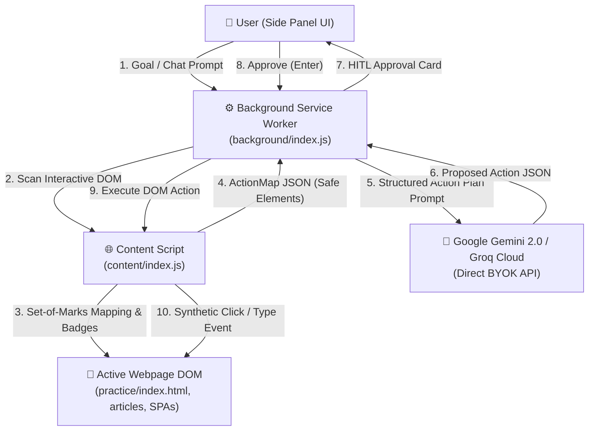

<div align="center">

# 🌟 Sahayak (सहायक)
### Human-in-the-Loop AI Browser Agent Chrome Extension

[](https://developer.chrome.com/docs/extensions/mv3/intro/)
[](https://ai.google.dev/)
[](https://github.com)
[](https://github.com)
[](LICENSE)

<p align="center">
  <strong>Sahayak ("सहायक" — Companion/Assistant)</strong> is a privacy-first, human-in-the-loop AI browser assistant built for Google Chrome. It grounds deep page understanding into conversational chat and executes multi-step web actions step-by-step with numbered Set-of-Marks badges, under complete human supervisory approval.
</p>

[Quick Start](#-quick-start-3-minutes) • [Core Features](#-core-features) • [Practice Sandbox](#-interactive-practice-sandbox) • [Architecture](#-architecture) • [Security & Privacy](#-privacy--security-declarations)

---

</div>

## 📑 Table of Contents
1. [Core Features](#-core-features)
2. [Quick Start (3 Minutes)](#-quick-start-3-minutes)
3. [Bring-Your-Own-Key (BYOK) Setup](#-bring-your-own-key-byok-setup)
4. [Interactive Practice Sandbox](#-interactive-practice-sandbox)
5. [Keyboard Shortcuts & Controls](#-keyboard-shortcuts--controls)
6. [Architecture & Flow](#-architecture)
7. [Privacy & Security Declarations](#-privacy--security-declarations)
8. [Testing & Verification](#-testing--verification)
9. [Project Structure](#-project-structure)
10. [License](#-license)

---

## 🚀 Core Features

### 1. 💬 Grounded Page & YouTube Understanding (Zero Hallucinations)
- **Article Readability Cleaner:** Strips ads, cookie banners (`#onetrust-banner-sdk`, `#CybotCookiebotDialog`), sticky navigations, social widgets, and paywall overlays across BBC News, Wikipedia, The Verge, Substack, Medium, and technical blogs.
- **YouTube Dialogue Grounding:** Fetches manual captions, auto-generated ASR subtitle streams, or chapter fallbacks with formatted `[MM:SS]` timestamps.
- **Anti-Prompt-Injection Safeguards:** Strips hidden zero-size elements, CSS opacity hacks, and suspicious instruction overrides before feeding text into the LLM context.

### 2. 🌐 Bilingual by Design: English & Hinglish
- Instant 1-click language pill (`EN` | `HI-EN`) in the Side Panel header.
- **Natural Hinglish:** Generates culturally intuitive conversational Hindi written strictly in clean Latin script (*"Form me traveler name Rohan Mehra fill kar rahe hain..."*), without awkward Devanagari font rendering issues in Chrome Side Panel.

### 3. 👁️ Multimodal Screen Vision
- Capture the current visible browser tab with 1 click.
- Powered by Google Gemini 2.0 Flash multimodal vision to analyze dashboards, charts, infographics, checkout carts, layout errors, and visual tables.

### 4. 🎯 Set-of-Marks (SoM) Visual Action Planning
- Scans visible interactive elements (buttons, links, inputs, selects, textareas, checkboxes) and injects numbered high-contrast badges (`#1`, `#2`, `#3`...).
- Automatically scrolls target elements into viewport and pulses with target highlight rings.

### 5. 🛡️ Strict Human-in-the-Loop (HITL) Supervisor
- **Zero Autonomous Runaway:** The AI model **proposes** one atomic action at a time (e.g. `CLICK`, `TYPE`, `SELECT`, `SCROLL`).
- **Human Approval Card:** You review the proposed action and explanation before any synthetic event is dispatched.
- **Instant Controls:** Press **Enter** to `Approve`, **Tab** to `Skip`, or **Esc** to `Stop`.

### 6. 👤 Local Profile Vault & Smart Field Matching
- Store your personal contact, travel, and professional details securely on your machine (`chrome.storage.local`).
- **Heuristic Profile Matcher:** Automatically matches form fields across multi-step wizards with confidence scoring ($\ge 0.85$), saving minutes of repetitive data entry.

### 7. ⚡ 1-Click Skills Library
- Pre-built automation blueprints:
  - 📝 **Fill Registration Form:** Smart profile autofill.
  - 🔍 **Search GitHub Issues:** Query repositories and filter PRs.
  - 🎥 **Analyze YouTube Video:** Comprehensive chapter and key-takeaway breakdown.
  - 📊 **Extract Page Data:** Structure tables and text into clean markdown.
- **Custom Skill Creator:** Save your own prompt workflows with custom icons and targets.

### 8. 🔒 Security Sandbox & Domain Blacklist
- **Automated Hard Lockout:** Automatically pauses automation on banking institutions (`chase.com`, `hdfcbank.com`), payment gateways (`paypal.com`, `stripe.com`), crypto exchanges (`binance.com`, `coinbase.com`), government tax portals (`incometax.gov.in`, `irs.gov`), and browser internal pages (`chrome://`).
- **Sensitive Field Isolation:** Passwords, OTPs, CVVs, and credit card numbers are strictly omitted from Set-of-Marks mapping (`excludedSensitiveCount++`), receive no badge, and are blocked from automation.

### 9. 🔄 SPA Navigation & Rate-Limit Hardening
- Detects HTML5 History API route changes (`pushState`, `replaceState`, `popstate`, `yt-navigate-finish`) and purges stale DOM registries.
- **Interactive Rate Limit Countdown:** Animated visual countdown with 1-click **Cancel Retry** button during HTTP 429 backoff.
- **Service Worker Keep-Alive:** Long-lived port channels prevent background worker dormancy during active streaming.

---

## ⏱ Quick Start (3 Minutes)

### Option A: Install Pre-Packaged Release (Fastest)
1. Download the latest release archive [`sahayak-v1.0.1.zip`](https://github.com/hemanpreetk/AI-BROWSER/releases).
2. Unzip the file into a folder on your computer.
3. Open Google Chrome and navigate to `chrome://extensions`.
4. Turn on **Developer mode** (top-right toggle).
5. Click **Load unpacked** and select the unzipped `dist` folder.
6. Click the Extensions puzzle icon in Chrome and **Pin Sahayak** to your toolbar!

### Option B: Build from Source
```bash
# 1. Clone the repository
git clone https://github.com/hemanpreetk/AI-BROWSER.git
cd AI-BROWSER

# 2. Install dependencies
npm install

# 3. Build the production extension bundle
npm run build

# 4. (Optional) Run tests to verify your environment
npm test

# 5. (Optional) Create production zip package
npm run package
```
Then load the `dist/` directory in `chrome://extensions` via **Load unpacked**.

---

## 🔑 Bring-Your-Own-Key (BYOK) Setup

Sahayak requires zero cloud accounts, monthly subscriptions, or external proxy servers. It connects directly from your browser to AI providers using your own free API keys:

1. Click the **Gear Icon (⚙️)** in the Sahayak header to open Settings.
2. Enter one or both API keys:
   - **Google Gemini API Key (Recommended):** Get a free key from [Google AI Studio](https://aistudio.google.com/app/apikey).
   - **Groq Cloud API Key (Blazing Fast):** Get a free key from [Groq Console](https://console.groq.com/keys).
3. Click **Save Settings**.
4. Your keys are encrypted and stored **strictly on your local device** (`chrome.storage.local`). They are never relayed through any secondary backend or cloud server.

---

## 🧪 Interactive Practice Sandbox

Sahayak comes bundled with a dedicated offline practice sandbox to test and explore every capability without affecting real websites:

```bash
npm run practice
```
1. Opens the local practice sandbox at `http://localhost:4173/`.
2. Includes five comprehensive test environments:
   - ✈️ **Flight Booking Form:** Multi-type controls, checkboxes, and protected security cards.
   - 📝 **W3Schools Forms:** Standard HTML5 input validation and select menus.
   - 📋 **Customer Feedback Survey:** Radios, ratings, and textareas.
   - 🧙 **Multi-Step Questionnaire Wizard:** Dynamic step transitions (Account $\rightarrow$ Profile $\rightarrow$ Review).
   - 🐙 **GitHub Issue SPA Sandbox:** Dynamic tabs (`Conversation`, `Commits`, `Files Changed`) and reaction bars.

---

## ⌨ Keyboard Shortcuts & Controls

| Action | Shortcut / Trigger | Description |
| :--- | :--- | :--- |
| **Open Sahayak Side Panel** | `Alt + Shift + S` *(Mac: `Option + Shift + S`)* | Toggles the Chrome Side Panel on the active tab |
| **Approve Action Step** | `Enter` | Executes currently proposed HITL action in supervisor |
| **Skip Action Step** | `Tab` | Skips proposed action and plans alternative next step |
| **Stop Supervisor** | `Escape` | Immediately halts running automation loop |
| **Switch Language** | Click `EN` / `HI-EN` Pill | Toggles between English and Latin-script Hinglish |
| **Capture Viewport** | Click `📸 Capture Screen` | Takes instant screenshot for multimodal analysis |
| **Right-Click Context Menu** | Highlight text $\rightarrow$ Right-Click | Select *Explain*, *Translate*, or *Draft Reply* |

---

## 🏗 Architecture

Sahayak operates as a fully client-side Chrome Extension under Google's strict **Manifest V3** security standard:



### Module Responsibilities:
- **`src/sidepanel/`**: React 18 + TailwindCSS user interface (Chat View, HITL Supervisor, Profile Vault, 1-Click Skills, Settings).
- **`src/background/`**: Manifest V3 service worker managing LLM orchestration, structured prompt generation, service worker lifecycle hydration, port keep-alive, and security gatekeeping.
- **`src/content/`**: In-page scripts for Set-of-Marks badge rendering (`somOverlay.ts`), DOM scanning (`somMapper.ts`), article cleaning (`readabilityScraper.ts`), YouTube transcript extraction (`youtubeTranscript.ts`), and synthetic event execution (`actionRunner.ts`).
- **`src/shared/`**: Common TypeScript contracts, message types, constants, and profile matcher heuristics.

---

## 🛡 Privacy & Security Declarations

- **Zero Cloud Relay:** No proxy servers, analytics servers, or remote logging endpoints exist. The extension runs 100% locally in your browser.
- **No Remote Code Execution:** Complies with Manifest V3 policies. Zero `eval()`, zero `new Function()`, zero remote CDN scripts.
- **Password & Credential Isolation:** Passwords (`type="password"`), one-time passcodes (`autocomplete="one-time-code"`), and credit cards (`autocomplete="cc-number"`) are strictly filtered from the Action Map and blocked from synthetic interaction.
- **Automated Banking Domain Protection:** Financial portals and identity providers are locked out automatically to ensure personal safety.

---

## 🧪 Testing & Verification

Sahayak features a comprehensive automated test suite consisting of **170 passing tests** verifying every phase:

```bash
# Run all test suites
npm test
```

### Test Coverage Highlights:
- **Phase 1 (Foundations & Grounding):** 33 tests verifying Groq & Gemini clients, article readability across 5 major sites, anti-injection filters, and Hinglish grounding.
- **Phase 2 (Context Menus & Multimodal Vision):** 32 tests verifying right-click menu routing, viewport screenshot compression, tone presets, and draft composition.
- **Phase 3 (Set-of-Marks & Action Planning):** 52 tests verifying coordinate calculations, visual badge rendering, structured JSON schemas, synthetic DOM clicks/typing, and multi-step feedback loops.
- **Phase 4 (Profile, Safety & Cross-Site Matrix):** 53 tests verifying heuristic profile matching, domain blacklists, SPA history events, rate-limit backoff timers, and real-world matrix edge cases.

---

## 📂 Project Structure

```
AI-BROWSER/
├── dist/                     # Compiled production bundle for Chrome
├── dist-zip/                 # Packaged release archives (sahayak-v1.0.1.zip)
├── practice/                 # Interactive practice sandbox (HTML5 + CSS + JS)
│   └── index.html
├── public/                   # Static extension assets and icons
│   ├── icons/                # 16px, 32px, 48px, 128px PNGs + master SVG
│   └── styles/               # Set-of-Marks badge stylesheet
├── scripts/                  # Build, test, and packaging scripts
│   ├── package-extension.mjs # Production zip archiver with SHA-256
│   ├── serve-practice.mjs    # Local sandbox dev server (port 4173)
│   └── test-phase*.mjs       # Automated test runner suites
├── src/
│   ├── background/           # Service worker, LLM clients, SafetyGuard
│   ├── content/              # DOM scanners, SoM overlay, action runner
│   ├── shared/               # TypeScript interfaces, types, constants
│   └── sidepanel/            # React 18 Side Panel UI components
├── manifest.json             # Chrome Manifest V3 configuration
├── package.json              # NPM dependencies & scripts
├── tsconfig.json             # TypeScript compiler configuration
├── vite.config.ts            # Vite & esbuild multi-entry bundler
├── architecture.md           # Architectural specification document
├── implementation-plan.md    # 4-Week phased milestone roadmap
├── INSTALL.md                # Comprehensive installation & setup guide
└── README.md                 # Project documentation & walkthrough
```

---

## 📄 License

This project is licensed under the [MIT License](LICENSE) — see the LICENSE file for details.

Developed with ❤️ for safe, intelligent, and human-guided web browsing.

