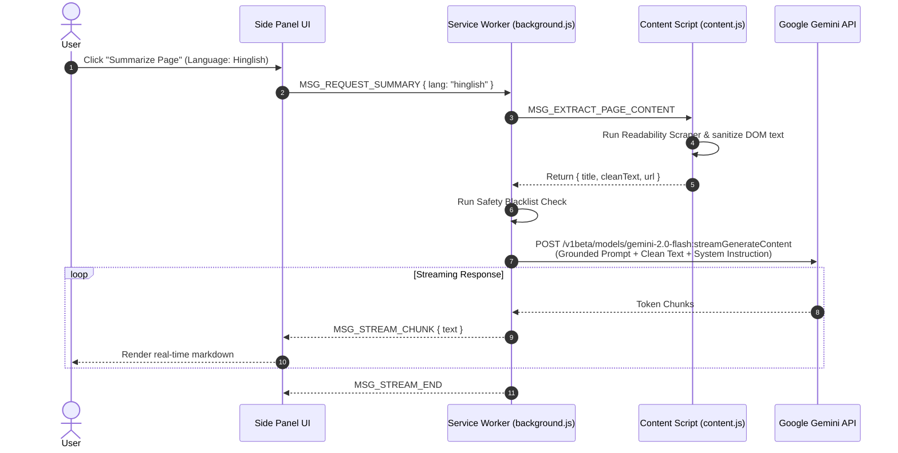
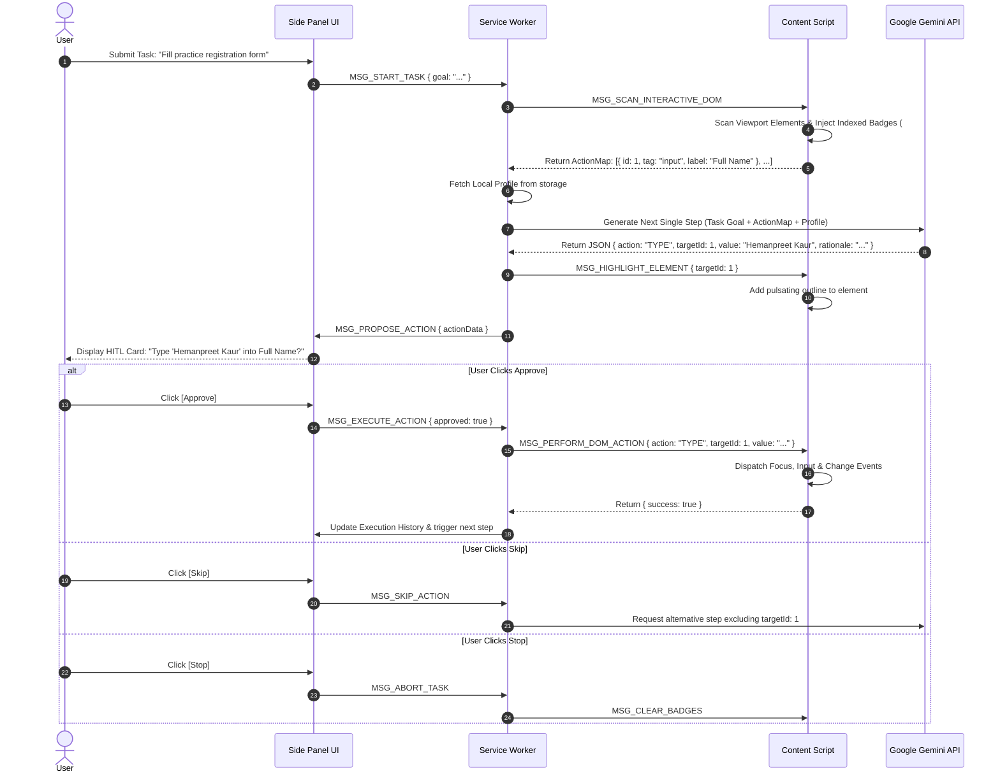
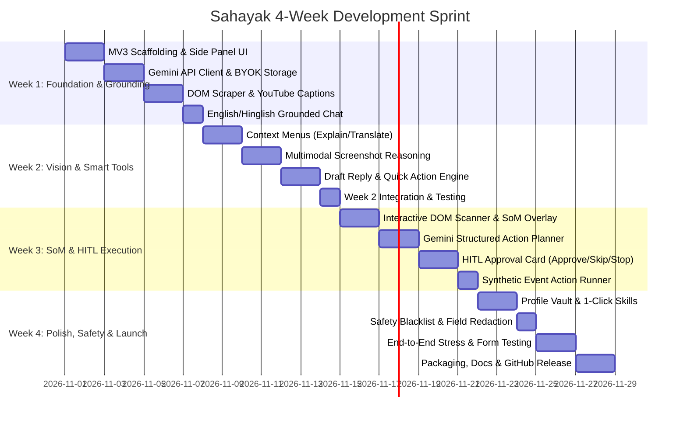

# Technical Architecture Document: Sahayak AI Browser Agent
**Platform:** Google Chrome Extension (Manifest V3)  
**Timeline:** 4-Week Production Sprint  
**Version:** 1.0.0-PROPOSAL  
**Target Release:** Open Source Public GitHub Release  

---

## 1. Executive Summary & Core Philosophy

**Sahayak** ("सहायक" / Helper) is a privacy-first, human-in-the-loop AI agent running natively inside the Google Chrome Side Panel. Unlike generic chatbot extensions that operate detached from web pages, Sahayak bridges the gap between **page understanding** and **supervised browser action**.

### Core Tenets
1. **Human-in-the-Loop Supremacy (Zero Unsupervised Mutation):** Sahayak never performs clicks, keystrokes, form submissions, or navigations autonomously. Every action is proposed as a distinct, inspectable step requiring explicit user consent (`Approve`, `Skip`, or `Stop`).
2. **Contextual Grounding (Anti-Hallucination):** Page conversations and summaries are strictly anchored to the active tab's sanitized DOM or YouTube video transcripts. If information does not exist on the page, the model explicitly acknowledges it.
3. **Set-of-Marks (SoM) Interactive DOM Mapping:** The agent converts visible interactive HTML elements into indexed, numbered visual overlays that both the user and the vision/text LLM can visually identify without fragile CSS/XPath guessing.
4. **Privacy-First & Local Storage:** No intermediary cloud relay backend is required. API requests stream directly from the user's browser to the AI provider (Google Gemini Flash Free Tier) using Bring-Your-Own-Key (BYOK). User profiles and custom skills reside strictly in `chrome.storage.local`.
5. **Strict Safety Sandbox:** Built-in blacklists actively prevent running the agent on banking, fintech, medical, password-reset, and authentication URLs, and automatically block interaction with sensitive input fields (e.g., passwords, credit card numbers, OTPs).

---

## 2. High-Level System Architecture

The following diagram illustrates the interaction between Chrome extension boundaries, runtime scripts, sandbox layers, and external APIs under Manifest V3:

```mermaid
flowchart TB
    subgraph Browser["Google Chrome Environment (Manifest V3)"]
        subgraph SidePanel["Side Panel (UI Layer)"]
            UI["Side Panel Application\n(React/HTML5 + Vanilla CSS)"]
            ChatEngine["Chat & Summarizer View"]
            HITLCard["HITL Action Approval Card\n[Approve | Skip | Stop]"]
            ProfileManager["Profile & Skills Manager"]
        end

        subgraph BackgroundWorker["Service Worker (Orchestration Engine)"]
            SW["background.js (Service Worker)"]
            MsgBus["Message Broker & Router"]
            LLMClient["Gemini API Client\n(gemini-2.0-flash / 1.5-flash)"]
            ContextMenus["Context Menu Handler\n(Explain / Translate / Draft)"]
            CaptureManager["Screen Capture Manager\n(chrome.tabs.captureVisibleTab)"]
            SafetyEngine["Safety & Blacklist Validator"]
        end

        subgraph ActiveTab["Active Tab (Content Script Layer)"]
            CS["content.js (Injected Script)"]
            DOMScraper["Page & Readability Scraper"]
            YouTubeScraper["YouTube Transcript Extractor"]
            DOMMapper["Set-of-Marks (SoM) Engine\n(Interactive Element Indexer)"]
            ActionExecutor["DOM Action Executor\n(Click, Type, Select, Scroll)"]
            OverlayCanvas["Numbered Badges Overlay"]
        end

        subgraph LocalStorage["Persistent Storage Layer"]
            Storage["chrome.storage.local\n(Encrypted API Keys, Profile, Skills, Logs)"]
        end
    end

    subgraph External["External Cloud Services (Free Tier)"]
        GeminiAPI["Google Gemini API\n(Flash 2.0 / 1.5 Flash REST Endpoint)"]
        YTPlayerAPI["YouTube TimedText / Caption Stream"]
    end

    %% Communications
    UI <-->|chrome.runtime Messaging| MsgBus
    MsgBus <-->|chrome.tabs Messaging| CS
    SW <--> Storage
    SW <-->|Direct REST / Fetch API| GeminiAPI
    CS <-->|TimedText Fetch| YTPlayerAPI
    CaptureManager -->|Capture Viewport| ActiveTab
    DOMMapper -->|Renders Markers| OverlayCanvas
    ActionExecutor -->|Dispatches Events| ActiveTab
    SafetyEngine -.->|Enforces Constraints| MsgBus
```



---

## 3. Extension Subsystems & Component Specifications

### 3.1. Side Panel UI Subsystem (`/src/sidepanel`)
- **Technology:** React 18 or Modular Vanilla JS/HTML5 with CSS Design Tokens (Glassmorphic dark/light palette, high accessibility contrast).
- **Views:**
  1. **Chat & Grounding Tab:** Real-time conversational interface with language toggles (**English** vs. **Hinglish**), context citations, and token-saving streaming outputs.
  2. **Page Tools Tab:** Quick-action cards: *Summarize Article*, *Summarize YouTube*, *Explain Selection*, *Translate*, *Screenshot Query*.
  3. **Action Agent Tab:** Interactive step-by-step executor showing the live action queue, highlighted visual snapshot, target element ID, and `[Approve]` / `[Skip]` / `[Stop]` buttons.
  4. **Vault & Skills Tab:** Local user profile configuration (Full Name, Email, Address, Portfolio links) and customizable 1-click prompt recipes.
  5. **Settings Tab:** BYOK Gemini API key validator, blacklist manager, response language preferences.

### 3.2. Background Service Worker Subsystem (`/src/background`)
- **Lifecycle Management:** Runs as an ephemeral event-driven worker compliant with Chrome MV3. State is persisted in `chrome.storage.session` and `chrome.storage.local` to survive worker termination.
- **Responsibilities:**
  - **Context Menu Integration:** Hooks into `chrome.contextMenus` for highlighted text actions ("*Sahayak: Explain*", "*Sahayak: Translate to Hinglish*", "*Sahayak: Draft Reply*").
  - **Screen Capture Coordinator:** Calls `chrome.tabs.captureVisibleTab` (JPEG, quality: 75%) to minimize token payloads before forwarding to Gemini Multimodal endpoints.
  - **LLM Gateway:** Manages API headers, system instructions, temperature calibration, exponential backoff retries, and schema-constrained JSON outputs.

### 3.3. Content Script Subsystem (`/src/content`)
- **Isolation:** Runs in an isolated world with access to the DOM.
- **Modules:**
  - **`domExtractor.js`:** Implements an optimized Mozilla Readability port to extract main article text, strip ads, scripts, svgs, and stylesheets, trimming page tokens by up to 80%.
  - **`youtubeExtractor.js`:** Injected on `*://*.youtube.com/watch*`. Reads video title, description, and pulls timed transcript segments from the YouTube player API / `captionTracks` XML stream without external third-party paid scrapers.
  - **`somMapper.js` (Set-of-Marks Generator):** Scans the viewport for actionable elements:
    - `<a>`, `<button>`, `<input>`, `<textarea>`, `<select>`, `[role="button"]`, `[tabindex="0"]`, `[contenteditable="true"]`.
    - Computes bounding client rects. Filters out invisible elements (`display: none`, `opacity: 0`, zero dimensions, obscured elements).
    - Injects non-intrusive floating badges (`#1`, `#2`, `#3`) with high-contrast colors onto the DOM.
    - Serializes the action map into a compact JSON schema for the LLM.
  - **`actionRunner.js`:** Dispatches synthetic events mimicking user behavior (`focus`, `keydown`, `keypress`, `input`, `change`, `keyup`, `click`, `scrollIntoView({ behavior: 'smooth' })`).

---

## 4. Detailed Data Flows & Sequence Workflows

### 4.1. Page-Grounded Chat & Article Summarization Flow



### 4.2. Set-of-Marks (SoM) Human-in-the-Loop Browser Action Flow



---

## 5. Element Action Map & Set-of-Marks (SoM) Specification

### 5.1. DOM Filtering Heuristic
Elements are qualified for indexing if and only if:
1. `getBoundingClientRect()` returns `width >= 8px`, `height >= 8px`, and intersects with the current viewport.
2. `getComputedStyle(el)` confirms `visibility !== 'hidden'`, `display !== 'none'`, and `opacity > 0.1`.
3. The element matches:
   - `input, button, select, textarea, a[href]`
   - `[role="button"], [role="link"], [role="checkbox"], [role="radio"], [role="combobox"], [role="tab"]`
   - Elements with active inline `onclick` or `tabindex >= 0`

### 5.2. Action Map JSON Schema
Sent from `content.js` to `background.js` and fed to Gemini:

```json
{
  "viewport": { "width": 1280, "height": 800, "scrollY": 350 },
  "elements": [
    {
      "id": 1,
      "tag": "input",
      "type": "text",
      "name": "applicant_name",
      "label": "Full Name",
      "placeholder": "Enter your legal name",
      "currentValue": "",
      "selector": "#app-form > div:nth-child(1) > input"
    },
    {
      "id": 2,
      "tag": "select",
      "label": "Country of Residence",
      "options": ["India", "United States", "Canada", "Germany"],
      "currentValue": "India",
      "selector": "#country-select"
    },
    {
      "id": 3,
      "tag": "button",
      "text": "Submit Application",
      "role": "button",
      "selector": "button.btn-primary"
    }
  ]
}
```

### 5.3. LLM Action Proposal Response Schema
Gemini is constrained via `responseSchema` (Structured JSON Outputs):

```json
{
  "type": "OBJECT",
  "properties": {
    "status": { "type": "STRING", "enum": ["ACTION_PROPOSED", "TASK_COMPLETED", "CANNOT_PROCEED"] },
    "thought": { "type": "STRING", "description": "Internal chain-of-thought rationale" },
    "userExplanation": { "type": "STRING", "description": "Concise explanation displayed to user in English or Hinglish" },
    "action": {
      "type": "OBJECT",
      "properties": {
        "actionType": { "type": "STRING", "enum": ["CLICK", "TYPE", "SELECT", "SCROLL", "WAIT"] },
        "targetElementId": { "type": "INTEGER" },
        "value": { "type": "STRING", "description": "Text to type or option value to select (if applicable)" },
        "scrollDirection": { "type": "STRING", "enum": ["UP", "DOWN", "TOP", "BOTTOM"] }
      },
      "required": ["actionType"]
    }
  },
  "required": ["status", "thought", "userExplanation"]
}
```

---

## 6. Safety, Privacy & Security Architecture

### 6.1. Domain Blacklist Engine
Before triggering DOM extraction or the action mapper, `background.js` matches the tab URL against a strict regex blacklist:

| Category | Regex / Host Match Pattern | Enforced Action |
| :--- | :--- | :--- |
| **Online Banking & Fintech** | `*://*.bankofamerica.com/*`, `*://*.chase.com/*`, `*://*.hdfcbank.com/*`, `*://*.icicibank.com/*`, `*://*.paypal.com/*`, `*://*.stripe.com/*` | **Hard Lockout:** Action engine disabled. Chat warns user: *"Sensitive financial site detected."* |
| **Authentication & IAM** | `*://accounts.google.com/*`, `*://login.microsoftonline.com/*`, `*://auth0.com/*`, `*://github.com/login*` | **Hard Lockout:** No DOM extraction or action proposal allowed. |
| **Government & Tax Portals** | `*://*.incometax.gov.in/*`, `*://*.uidai.gov.in/*`, `*://*.irs.gov/*` | **Hard Lockout:** Prevent any automated filling. |
| **Local / Extension Internal** | `chrome://*`, `chrome-extension://*`, `about:*` | **Browser Protected:** Extension cannot execute scripts. |

### 6.2. Sensitive Input Field Redaction
During the DOM scanning phase (`somMapper.js`), any element satisfying the following conditions is **scrubbed and omitted** from the Action Map:
1. `type="password"`
2. Form control attributes: `name`, `id`, `autocomplete`, or `aria-label` matching:
   - `/(pass|pwd|secret|token|cvv|cvc|creditcard|cc-num|exp-date|ssn|aadhaar|otp|pin)/i`
3. If an action inadvertently targets a sensitive field, the Content Script drops execution immediately and logs an error to the user interface.

### 6.3. Zero-Server Privacy Model & BYOK
- **No Proxy Servers:** User data travels solely between Chrome and `https://generativelanguage.googleapis.com`.
- **API Key Security:** Stored locally in `chrome.storage.local` with encryption/sanitization. Key is never emitted in console logs or extension telemetry.

---

## 7. Bilingual Engine: English & Hinglish System Prompts

Sahayak features native bilingual fluency. When Hinglish mode is toggled, it crafts explanations in authentic colloquial Hindi written in Roman script (popular across India and South Asia), while keeping technical labels and UI elements clear.

### Prompt Directive Template:
```text
You are Sahayak (सहायक), a smart, respectful, and safe browser companion.
Operating Mode: [MODE: ENGLISH | HINGLISH]
Current Web Page: [URL] | Title: [TITLE]

Language Directives:
- If MODE is HINGLISH: Respond in natural, conversational Hinglish (Hindi words written in English/Latin script).
  Example: "Maine page ka summary read kar liya hai. Is article me 3 main points discuss kiye gaye hain..."
- If MODE is ENGLISH: Respond in clear, concise modern British/American English.
- Grounding Rule: Answer strictly using facts found in the provided Page Context. Never extrapolate or invent external details.
- Safety Rule: If the user asks you to interact with sensitive credentials, decline politely.
```

---

## 8. File & Directory Structure

```text
AI-BROWSER/
├── manifest.json                  # Manifest V3 configuration
├── package.json                   # Dependencies & build scripts
├── vite.config.js                 # Vite bundler config for Chrome Extension
├── tsconfig.json                  # TypeScript compiler settings (or JS config)
├── problemStatement.md            # User problem statement & project constraints
├── architecture.md               # Complete technical architecture specification
├── public/
│   ├── icons/
│   │   ├── icon-16.png
│   │   ├── icon-32.png
│   │   ├── icon-48.png
│   │   └── icon-128.png
│   └── styles/
│       └── som-overlay.css        # Styles for Set-of-Marks badges & highlights
├── src/
│   ├── background/
│   │   ├── index.ts               # Service Worker entrypoint
│   │   ├── geminiClient.ts        # Gemini REST client (Streaming & Structured)
│   │   ├── contextMenus.ts        # Right-click context menu registry
│   │   ├── safetyGuard.ts         # Domain blacklist & sensitive field rules
│   │   └── tabCapture.ts          # Screenshot capture coordinator
│   ├── content/
│   │   ├── index.ts               # Content script entrypoint & message router
│   │   ├── readabilityScraper.ts  # DOM text extraction & cleaning algorithm
│   │   ├── youtubeTranscript.ts   # YouTube caption track scraper
│   │   ├── somMapper.ts           # Set-of-Marks generator & badge overlay
│   │   └── actionRunner.ts        # Synthetic DOM action execution engine
│   ├── sidepanel/
│   │   ├── index.html             # Chrome Side Panel HTML wrapper
│   │   ├── index.tsx              # React / UI Application root
│   │   ├── index.css              # Custom styling tokens (dark/light mode)
│   │   ├── components/
│   │   │   ├── Header.tsx         # Title, status indicator, language toggle
│   │   │   ├── ChatView.tsx       # Message list, streaming bubble, input box
│   │   │   ├── QuickActions.tsx   # Summarize, YouTube, Screenshot buttons
│   │   │   ├── HITLApproval.tsx   # Action proposal card (Approve/Skip/Stop)
│   │   │   ├── ActionHistory.tsx  # Audit log of proposed vs executed actions
│   │   │   ├── ProfileVault.tsx   # User profile form editor
│   │   │   └── SettingsModal.tsx  # API key input, blacklist viewer
│   │   └── hooks/
│   │       ├── useExtensionMsg.ts # Typed Chrome runtime message hooks
│   │       └── useStorage.ts      # Reactive chrome.storage.local hook
│   ├── shared/
│   │   ├── types.ts               # Shared TypeScript interfaces & message types
│   │   ├── constants.ts           # Storage keys, blacklists, default prompts
│   │   └── helpers.ts             # String utils, DOM selector sanitizers
│   └── skills/
│       └── builtinSkills.json     # Predefined 1-click skills (Summarize, Polish, etc.)
└── dist/                          # Production-ready unpacked extension build
```

---

## 9. Manifest V3 Configuration (`manifest.json`)

```json
{
  "manifest_version": 3,
  "name": "Sahayak - AI Browser Agent",
  "version": "1.0.0",
  "description": "Safe, human-in-the-loop AI side panel agent for web page understanding and guided action execution.",
  "icons": {
    "16": "icons/icon-16.png",
    "32": "icons/icon-32.png",
    "48": "icons/icon-48.png",
    "128": "icons/icon-128.png"
  },
  "permissions": [
    "sidePanel",
    "activeTab",
    "scripting",
    "storage",
    "contextMenus",
    "tabs"
  ],
  "host_permissions": [
    "<all_urls>"
  ],
  "background": {
    "service_worker": "background/index.js",
    "type": "module"
  },
  "side_panel": {
    "default_path": "sidepanel/index.html"
  },
  "content_scripts": [
    {
      "matches": ["<all_urls>"],
      "js": ["content/index.js"],
      "css": ["styles/som-overlay.css"],
      "run_at": "document_idle"
    }
  ],
  "action": {
    "default_title": "Open Sahayak"
  }
}
```

---

## 10. Four-Week Sprint Implementation Roadmap

The project is structured into four focused 1-week sprints to deliver a tested, robust, and publishable GitHub release.



### Detailed Day-by-Day Milestone Breakdown

#### 📅 Week 1: Core Scaffolding, Side Panel & Page-Grounded Understanding
* **Goal:** A functioning Chrome extension with a side panel that reads the active tab / YouTube video and answers questions accurately in English and Hinglish.
* **Day 1:** Project initialization (Vite, TypeScript, Tailwind/Vanilla CSS), `manifest.json` MV3 setup, Side Panel registration, and layout scaffolding.
* **Day 2:** Gemini API client integration in `background.js` (streaming responses, BYOK model via `chrome.storage.local`, API key configuration modal).
* **Day 3:** Article readability & DOM scraper in `content.js` to strip HTML bloat into clean, LLM-digestible markdown.
* **Day 4:** YouTube transcript parser: Video ID extraction, XML timed-text fetch, and fallback to metadata/description.
* **Day 5:** Grounded Q&A prompt pipeline: Enforce strict anti-hallucination constraint ("Answer only from page context").
* **Day 6:** English/Hinglish dual-language switch with customized system personas and tone calibration.
* **Day 7:** Sprint review, cross-site testing on Wikipedia, news portals (BBC, Indian Express), and YouTube videos.

#### 📅 Week 2: Context Menus, Multimodal Screenshot Vision & Selection Tools
* **Goal:** Interact with selected text directly from the right-click menu and analyze complex non-text page items using vision screenshots.
* **Day 8:** Implement `chrome.contextMenus` with actions: "Sahayak: Explain", "Sahayak: Translate to Hinglish", and "Sahayak: Draft Reply".
* **Day 9:** Message routing between context menu events, active tab selection, and Side Panel auto-activation.
* **Day 10:** Implement `chrome.tabs.captureVisibleTab` coordinator with WebP/JPEG compression to preserve free-tier tokens.
* **Day 11:** Gemini Multimodal integration: Send screenshot + user question to analyze charts, infographics, tables, and visual layout.
* **Day 12:** Selection reply composer: Context-aware email/comment drafting using selected text as reference.
* **Day 13:** Responsive markdown renderer in sidepanel (code blocks, syntax highlighting, copy-to-clipboard buttons).
* **Day 14:** Sprint review: Verify screenshot latency, visual reasoning accuracy, and context menu reliability across various tab types.

#### 📅 Week 3: Set-of-Marks (SoM) Engine & Human-in-the-Loop Execution
* **Goal:** Detect interactive elements, render numbered visual overlays, plan discrete browser steps, and execute upon user approval.
* **Day 15:** Build `somMapper.js`: Scan viewport for buttons, links, inputs, selects; calculate screen coordinates and inject numbered badges (`#1`, `#2`, ...).
* **Day 16:** Badge overlay styling (`som-overlay.css`): Ensure high z-index, non-intrusive positioning, pulsing target highlights, and zero layout shift.
* **Day 17:** Action planner prompt engineering: Send serialized Element Map to Gemini with structured JSON schema (`CLICK`, `TYPE`, `SELECT`, `SCROLL`).
* **Day 18:** Build Side Panel HITL Card: Display proposed action, target element preview, plain-language rationale, and `[Approve]`, `[Skip]`, `[Stop]` buttons.
* **Day 19:** Build `actionRunner.js`: Synthetic event dispatchers with proper event bubbling (`focus` -> `input` -> `change` -> `blur`).
* **Day 20:** Action feedback loop: After approval, execute action -> re-scan viewport -> generate next step until goal is satisfied.
* **Day 21:** Build execution history audit log: Render step-by-step history showing what was proposed and what the user approved.

#### 📅 Week 4: Profile Vault, 1-Click Skills, Safety Hardening & Public GitHub Release
* **Goal:** Safe, hardened, installable extension with local user memory, pre-built skills, documentation, and GitHub release binaries.
* **Day 22:** Profile Vault implementation: Local encrypted store for personal info (Name, Email, Phone, Socials) and smart form-fill mapping.
* **Day 23:** One-Click Skills Engine: Configurable macro buttons (e.g., "TL;DR & 3 Takeaways", "Summarize Comments", "Fill Practice Form").
* **Day 24:** Safety Guardrails: Enforce domain blacklist (banking, login portals) and sensitive field redaction (passwords, credit cards, OTPs).
* **Day 25:** End-to-end testing against real-world test benches (Formspree practice forms, W3Schools interactive forms, Single Page Apps).
* **Day 26:** Edge-case hardening: Handle tab switching, window resizing, SPA client-side routing, and API rate limits (exponential backoff).
* **Day 27:** Production build pipeline, manifest validation, asset optimization, comprehensive `README.md`, install guide, and demo GIFs/screenshots.
* **Day 28:** GitHub Release creation: Tag `v1.0.0`, provide packaged zip file, and publish complete source code repository.

---

## 11. Risk Analysis & Mitigation Matrix

| Identified Risk | Severity | Impact | Mitigation Strategy |
| :--- | :---: | :--- | :--- |
| **MV3 Service Worker Inactivity** | High | Worker goes dormant after 30s of inactivity, losing in-flight task state. | Persist task and step state into `chrome.storage.session`. Wake up worker via `chrome.runtime.sendMessage` from Side Panel. |
| **Single Page Application (SPA) Re-rendering** | High | React/Vue SPAs replace DOM nodes dynamically, causing stored element references to become stale. | Never rely on cached DOM node pointers. Generate fresh element maps per step; use resilient selectors + text heuristics. |
| **YouTube Caption Block or Missing Transcripts** | Medium | Some videos lack captions or block automated subtitle retrieval. | Fallback sequentially: 1) Extract manual subtitles -> 2) Extract auto-generated subtitles -> 3) Scrape title + description -> 4) Graceful UI alert. |
| **Gemini API Free-Tier Rate Limits (15 RPM)** | Medium | Rapid successive actions or token floods hit HTTP 429 errors. | Implement token-bucket client-side rate limiter and exponential backoff retry (1s, 2s, 4s). Display rate-limit countdown in UI. |
| **Sensitive Field Intrusion** | Critical | Agent accidentally reads or fills password or payment data. | Hard regex exclusion on inputs; DOM scraper immediately skips any input where `type === 'password'` or attributes match payment patterns. |
| **Visual Badge Overlap / Layout Shift** | Low | Injected Set-of-Marks badges break page styling or overlap buttons. | Use `position: absolute` with `pointer-events: none` on badges inside an isolated overlay container; badges never manipulate target node layout. |

---

## 12. Verification & Testing Matrix

To guarantee production readiness prior to GitHub release:

1. **Unit & Scraper Tests:**
   - Verify readability algorithm extracts clean markdown across 10 top news sites (NYTimes, BBC, Medium, Substack, etc.).
   - Verify YouTube scraper extracts transcripts across 5 sample videos (manual captions, auto-generated, and no-caption fallback).
2. **Safety & Blacklist Tests:**
   - Attempt to open Sahayak on test URLs (`chase.com`, `accounts.google.com`) and verify execution is completely blocked.
   - Test forms containing password, CC, and OTP fields to verify elements are excluded from the Action Map.
3. **HITL Action Tests:**
   - Run form-filling on practice forms (e.g., Google Forms test page, W3Schools form exercises).
   - Verify that no synthetic event fires without the user clicking `[Approve]`.
   - Verify `[Skip]` correctly prompts the model for an alternative element.
   - Verify `[Stop]` immediately tears down overlay badges and halts all execution.
4. **Bilingual Verification:**
   - Verify responses in Hinglish maintain natural grammar, accurate terminology, and respectful phrasing.

---

## 13. Deliverables Checklist for GitHub Release
- [x] Full source code repository with clean modular architecture.
- [x] Validated `manifest.json` passing Chrome Web Store automated linter.
- [x] Complete build script generating an unpacked `dist/` folder.
- [x] Comprehensive `README.md` containing:
  - Step-by-step developer installation (`chrome://extensions` Load Unpacked).
  - Architecture overview and workflow diagrams.
  - BYOK setup guide for free Google Gemini API key.
  - Video demo / GIF walkthrough of grounded summarization and HITL form filling.
- [x] Permissive open-source license (MIT or Apache 2.0).
