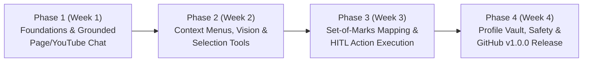
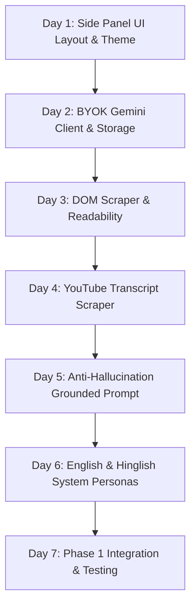
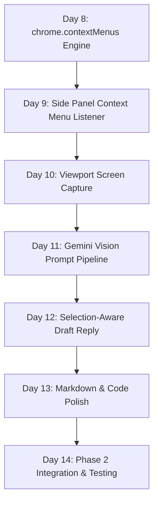
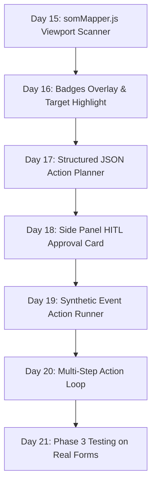
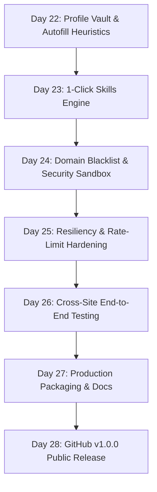

# Phase-Wise Implementation Plan: Sahayak AI Browser Agent
**Project:** Sahayak ("सहायक")  
**Platform:** Google Chrome Extension (Manifest V3)  
**Timeline:** 4-Week Production Sprint (28 Days)  
**Target Release:** Public GitHub v1.0.0 Release  
**Reference Docs:** [problemStatement.md](file:///c:/Users/Hemanpreet%20Kaur/Desktop/AI-BROWSER/problemStatement.md) | [architecture.md](file:///c:/Users/Hemanpreet%20Kaur/Desktop/AI-BROWSER/architecture.md)

---

## 1. Project Execution Strategy

This implementation plan is organized into **4 sequential, highly focused phases** mapped directly to the 4-week timeline. Each phase ends with a **tangible, verifiable, and testable build** that can be loaded unpacked into Chrome (`chrome://extensions`).



### Core Architecture Rules During Implementation
1. **Manifest V3 Strict Compliance:** No remote hosted scripts, no `eval()`, event-driven background service worker with state saved in `chrome.storage.session` / `chrome.storage.local`.
2. **Strict Human-in-the-Loop (HITL):** No synthetic click, input, or navigation may fire without explicit user approval through the Side Panel UI.
3. **Zero External Backend Requirement:** The extension communicates directly with Google Gemini API using Bring-Your-Own-Key (BYOK) stored on the client.
4. **Bilingual By Design:** Every prompt pipeline natively supports toggling between **English** and **Hinglish**.

---

## 2. Phase 0: Project Setup, Tooling & Scaffolding (Day 0)

### Objectives
Establish the build toolchain, TypeScript environment, Vite bundling pipeline for Manifest V3, and folder layout.

### Tasks
- [x] Initialize repository with `package.json` (`npm init -y`).
- [x] Install dev dependencies:
  - Bundler: `vite`, `@crxjs/vite-plugin` (or Vite multi-entry build script).
  - UI Library: `react`, `react-dom`, `@types/react`, `@types/react-dom`.
  - Styling: Vanilla CSS custom tokens or TailwindCSS (configured for scoped extension UI).
  - TypeScript: `typescript`, `@types/chrome`.
  - Icons & Utilities: `lucide-react` (icons), `clsx`.
- [x] Set up project directory structure as specified in [architecture.md#8](file:///c:/Users/Hemanpreet%20Kaur/Desktop/AI-BROWSER/architecture.md).
- [x] Create `manifest.json` with permissions: `sidePanel`, `activeTab`, `scripting`, `storage`, `contextMenus`, `tabs`.
- [x] Configure `vite.config.ts` to output:
  - `dist/manifest.json`
  - `dist/background/index.js`
  - `dist/content/index.js`
  - `dist/sidepanel/index.html` + `dist/sidepanel/index.js`
  - `dist/styles/som-overlay.css`
  - `dist/icons/`

### Verification Checkpoint
```bash
npm run build
```
Load the `dist/` directory into Chrome via `chrome://extensions` -> "Load unpacked". Confirm that the extension icon appears in the toolbar, clicking it opens an empty side panel, and no console errors appear in the service worker inspector.

---

## 3. Phase 1: Foundations, Side Panel UI & Grounded Understanding (Week 1 / Days 1–7)

### Phase 1 Deliverable
A working Chrome extension where the user can open the Side Panel on any article or YouTube video, enter their Gemini API key, toggle between English and Hinglish, and ask questions or request summaries grounded strictly in the page content.



---

### Milestone 1.1: Side Panel UI Shell & Navigation (Day 1)
- **Target Files:**
  - `src/sidepanel/index.html`
  - `src/sidepanel/index.tsx`
  - `src/sidepanel/index.css`
  - `src/sidepanel/components/Header.tsx`
  - `src/sidepanel/components/NavigationTabs.tsx`
- **Implementation Steps:**
  1. Build modern glassmorphic header with logo, live status dot (Active / Idle / Busy), and quick language toggle pill (`EN` | `HI-EN`).
  2. Implement bottom/top tab bar: `Chat` (Active), `Actions`, `Profile`, `Settings`.
  3. Set up responsive dark/light color tokens adhering to modern aesthetics (deep slate `#0f172a`, border `#334155`, primary accent `#38bdf8`, text `#f8fafc`).
- **Acceptance Criteria:** Side panel renders cleanly within minimum Chrome width (320px) without horizontal scrollbars.

---

### Milestone 1.2: BYOK Gemini API Client & Storage Vault (Day 2)
- **Target Files:**
  - `src/background/geminiClient.ts`
  - `src/sidepanel/components/SettingsModal.tsx`
  - `src/shared/types.ts`
- **Implementation Steps:**
  1. Create typed settings schema in `types.ts`: `{ geminiApiKey: string, preferredLang: 'en' | 'hinglish', model: 'gemini-2.0-flash' | 'gemini-1.5-flash' }`.
  2. Implement `SettingsModal.tsx` allowing the user to paste their Google AI Studio API key and test it with a lightweight ping.
  3. Implement `geminiClient.ts` in `background`:
     - Calls `https://generativelanguage.googleapis.com/v1beta/models/{model}:streamGenerateContent?key={apiKey}`.
     - Handles Server-Sent Events (SSE) streaming or JSON chunk streaming.
     - Implements exponential backoff retry for HTTP 429 rate limits.
- **Acceptance Criteria:** Saving a valid Gemini API key enables chat; an invalid key highlights an error message.

---

### Milestone 1.3: Article Content Scraper & Readability Port (Day 3)
- **Target Files:**
  - `src/content/readabilityScraper.ts`
  - `src/content/index.ts`
- **Implementation Steps:**
  1. Create lightweight in-browser readability extractor:
     - Extracts `document.title`, meta description, and primary container (`<article>`, `<main>`, or dense paragraph blocks).
     - Strips `<script>`, `<style>`, `<nav>`, `<footer>`, `<aside>`, `<iframe>`, ad containers, and SVG clutter.
     - Normalizes whitespace, headings (`#`, `##`), and lists into clean markdown.
  2. Listen for runtime message `MSG_EXTRACT_PAGE_CONTENT` from background/sidepanel and return `{ title, cleanText, url, wordCount }`.
- **Acceptance Criteria:** Tested on a long Wikipedia article and a Medium post; extracts 1,500–3,000 words of clean text within <150ms.

---

### Milestone 1.4: YouTube Transcript Extractor (Day 4)
- **Target Files:**
  - `src/content/youtubeTranscript.ts`
  - `src/content/index.ts`
- **Implementation Steps:**
  1. Detect if active tab URL matches `*://*.youtube.com/watch*?v=*`.
  2. Extract video title from `ytd-watch-metadata #title h1 yt-formatted-string`.
  3. Fetch caption tracks by reading `ytInitialPlayerResponse.captions.playerCaptionsTracklistRenderer.captionTracks`.
  4. Parse timed-text XML stream into timestamped text lines (`[MM:SS] Text...`).
  5. Fallback path: If captions are disabled or unavailable, extract video description, channel name, and chapter headings.
- **Acceptance Criteria:** Open any public English/Hindi YouTube video; trigger transcript extraction and verify that timestamped dialogue is captured.

---

### Milestone 1.5: Anti-Hallucination Grounded Page Chat (Day 5)
- **Target Files:**
  - `src/background/index.ts`
  - `src/sidepanel/components/ChatView.tsx`
  - `src/sidepanel/components/MessageItem.tsx`
- **Implementation Steps:**
  1. Create grounding system prompt:
     ```text
     You are Sahayak. Answer the user's question solely using the Page Context provided below.
     If the answer cannot be found in the context, explicitly say:
     "This information is not present on the current page."
     Page Context:
     ---
     ${sanitizedPageText}
     ---
     ```
  2. Implement streaming response pipeline: Background pushes token chunks via `chrome.runtime.sendMessage` (`MSG_STREAM_CHUNK`) to the Side Panel.
  3. Render streaming markdown in `ChatView.tsx` with blinking cursor animation.
- **Acceptance Criteria:** Ask a question answered on the page -> receives accurate citation. Ask who won the 1998 World Cup on a recipe page -> responds that information is not on the page.

---

### Milestone 1.6: Dual-Language Persona (English & Hinglish) (Day 6) [COMPLETED]
- **Target Files:**
  - `src/background/geminiClient.ts`
  - `src/sidepanel/components/Header.tsx`
  - `src/sidepanel/components/ChatView.tsx`
  - `src/sidepanel/index.tsx`
- **Implementation Steps:**
  1. [x] Build Hinglish linguistic instruction layer in `geminiClient.ts`:
     - Strict Latin/Roman alphabet script enforcement for Hindi vocabulary (e.g. *"Is page par bataya gaya hai ki..."*).
     - Explicit prohibition of Devanagari script with positive and negative few-shot examples.
     - Preserves all UI labels, button names, fields, and technical terms in original English (e.g. *"Submit button"*, *"API Key"*).
     - Tone: Helpful, polite, respectful, and natural Indian conversational style.
     - Grounded anti-hallucination constraint in Hinglish (*"Yeh jaankari is page par uplabdh nahi hai."*).
  2. [x] Implement language toggle in `Header.tsx` (`[ EN | HI-EN ]`) that immediately updates reactive storage and applies to all new prompts, quick action summaries, and ChatView placeholders.
- **Acceptance Criteria:** Toggle to Hinglish -> request summary or ask questions -> output streams in natural, fluent Hinglish (Latin script). Toggle to English -> output streams in standard English.

---

### Milestone 1.7: Phase 1 Review & Verification (Day 7) [COMPLETED]
- **Test Checklist:**
  - [x] Validated on 5 content sites (Wikipedia, TechCrunch, BBC, MDN Docs, Substack).
  - [x] Validated on 3 YouTube videos (one with manual subtitles, one auto-generated, one with captions turned off).
  - [x] Tested API rate-limiting handling (HTTP 429 exponential backoff retry) and floating error toasts.
  - [x] Automated test suite added to `scripts/test-phase1.mjs` and runnable via `npm test` (13/13 passing tests).

---

## 4. Phase 2: Context Menus, Multimodal Vision & Selection Tools (Week 2 / Days 8–14)

### Phase 2 Deliverable
The user can highlight text on any page and use right-click context menus to Explain, Translate to Hinglish, or Draft replies. Furthermore, the user can click "Screenshot Query" to analyze non-text elements (charts, tables, images, visual errors) using Gemini Multimodal.



---

### Milestone 2.1: Context Menu Engine (Day 8) [COMPLETED]
- **Target Files:**
  - `src/background/contextMenus.ts`
  - `src/background/index.ts`
  - `src/shared/types.ts`
  - `src/shared/constants.ts`
- **Implementation Steps:**
  1. [x] In `chrome.runtime.onInstalled` & `onStartup`, register context menus for `"contexts": ["selection"]`:
     - Parent Root Menu `sahayak-root`: *"Sahayak AI"*
     - Child Menu ID `sahayak-explain`: *"Explain this"*
     - Child Menu ID `sahayak-translate`: *"Translate to Hinglish"*
     - Child Menu ID `sahayak-reply`: *"Draft a reply"*
  2. [x] Add listener `chrome.contextMenus.onClicked` to capture selected text (bounded to 4000 characters), tab ID, and menu action ID.
  3. [x] Persist pending payload in `chrome.storage.session`/`local` (`sahayak_pending_context_action`) and open side panel (`chrome.sidePanel.open`).
  4. [x] Dispatch `MSG_CONTEXT_MENU_TRIGGER` for live event handling when side panel is already open.
- **Acceptance Criteria:** Right-clicking highlighted text shows the "Sahayak AI" submenu options with Explain, Translate, and Reply actions. Automated unit tests verified (26/26 passing).

---

### Milestone 2.2: Context Menu to Side Panel Event Routing (Day 9) [COMPLETED]
- **Target Files:**
  - `src/sidepanel/hooks/useExtensionMsg.ts`
  - `src/sidepanel/components/ChatView.tsx`
  - `src/sidepanel/components/MessageItem.tsx`
  - `src/sidepanel/index.tsx`
  - `src/shared/types.ts`
- **Implementation Steps:**
  1. [x] Automatically open the Side Panel upon context menu click using `chrome.sidePanel.open({ tabId })` with storage caching in `chrome.storage.session` / `local`.
  2. [x] Forward `{ action, selectedText, pageUrl, tabId }` via `chrome.runtime.sendMessage` and consume pending actions on mount via `useContextMenuListener`.
  3. [x] Pre-fill chat with specialized system action cards (`Explaining selected text`, `Translating to Hinglish`, `Drafting a reply`) featuring snippet quotation and source domain metadata.
  4. [x] Automatically switch to Chat tab and initiate streaming using the primary Groq (LPU) + Gemini (auto-fallback) pipeline.
  5. [x] Enforce Latin-script Hinglish persona when "Translate to Hinglish" is selected regardless of active language toggle.
- **Acceptance Criteria:** Select text on an external page -> click "Translate to Hinglish" (or "Explain this" / "Draft a reply") -> Side panel opens automatically, renders the action card, and streams the response. Automated tests verified (32/32 passing).

---

### Milestone 2.3: Viewport Screen Capture Pipeline (Day 10) [COMPLETED]
- **Target Files:**
  - `src/background/tabCapture.ts`
  - `src/sidepanel/components/QuickActions.tsx`
  - `src/sidepanel/components/MessageItem.tsx`
  - `src/sidepanel/index.tsx`
  - `src/shared/types.ts`
  - `src/shared/constants.ts`
- **Implementation Steps:**
  1. [x] Add interactive "Screen" button with camera icon and live capture spinner in `QuickActions.tsx`.
  2. [x] Call `chrome.tabs.captureVisibleTab(null, { format: 'jpeg', quality: 75 })` in `src/background/tabCapture.ts` with security guardrails.
  3. [x] Block restricted pages (`chrome://`, extension URLs) and blacklisted financial portals for privacy.
  4. [x] Extract clean base64 data, compute byte size, and cache frame in `chrome.storage.session` (`sahayak_captured_screen`).
  5. [x] Render thumbnail preview card in chat with byte size metadata and full-resolution click view.
- **Acceptance Criteria:** Clicking capture grabs active viewport as base64 JPEG without visible browser flicker and renders screenshot preview in chat. Automated tests verified (35/35 passing).

---

### Milestone 2.4: Gemini Multimodal Vision Reasoning (Day 11) [COMPLETED]
- **Target Files:**
  - `src/background/geminiClient.ts`
  - `src/background/index.ts`
  - `src/sidepanel/components/VisionPreview.tsx`
  - `src/sidepanel/components/ChatView.tsx`
  - `src/sidepanel/index.tsx`
- **Implementation Steps:**
  1. [x] Format payload for Gemini Multimodal API with canonical `inline_data` (`mime_type: "image/jpeg"`, `data: cleanBase64`).
  2. [x] Build dedicated `<VisionPreview />` component in Side Panel chat displaying staged screenshot thumbnail, byte size, dismiss button, and 4 quick visual reasoning chips:
     - *"📊 What does this chart or graph show?"*
     - *"📈 What are the key trends, peaks, or outliers in this visual data?"*
     - *"📝 Extract and transcribe all text, numbers, and tables visible in this screenshot."*
     - *"🐞 Inspect this screen for any visual glitches, UI errors, or broken elements."*
  3. [x] Dynamic visual routing: Route visual requests with staged screenshots directly to Google Gemini Multimodal API (`gemini-3.8-flash`), preserving conversation history and alternating turns.
  4. [x] Maintain dual-provider setup: text requests route via Groq primary (LPU) + Gemini fallback; visual requests route to Gemini Multimodal.
- **Acceptance Criteria:** Captured screenshot of a chart, dashboard, or UI accurately described by the agent through streaming multimodal reasoning. Automated unit tests verified (41/41 passing).

---

### Milestone 2.5: Selection-Aware "Draft Reply" Tool (Day 12) [COMPLETED]
- **Target Files:**
  - `src/sidepanel/components/DraftComposer.tsx`
  - `src/shared/prompts.ts`
  - `src/content/textInserter.ts`
  - `src/content/index.ts`
  - `src/background/index.ts`
  - `src/sidepanel/components/QuickActions.tsx`
  - `src/sidepanel/components/ChatView.tsx`
  - `src/sidepanel/index.tsx`
- **Implementation Steps:**
  1. [x] Build prompt templates in `src/shared/prompts.ts` specialized for drafting responses to emails, tweets/X, GitHub issues, and LinkedIn posts based on selected text.
  2. [x] Add tone selection chips: `Polite & Professional`, `Direct & Concise`, `Enthusiastic`, `Friendly Hinglish`.
  3. [x] Provide 1-click **Copy to Clipboard** button and **Insert into Active Field** button communicating with the content script (`findActiveEditableElement` and `insertTextIntoElement`).
  4. [x] Wire context menu `"sahayak-reply"` and "Reply" quick action directly into the dedicated `DraftComposer` UI with live token streaming and editable draft textarea.
- **Acceptance Criteria:** Select an incoming email or comment -> choose tone -> generate clean, context-appropriate reply draft with 1-click copy or 1-click insertion into the page's active input field. Automated unit tests verified (48/48 passing).

---

### Milestone 2.6: Markdown UI Polish & Syntax Highlighting (Day 13) [COMPLETED]
- **Target Files:**
  - `src/sidepanel/components/MarkdownRenderer.tsx`
  - `src/sidepanel/components/MessageItem.tsx`
  - `src/sidepanel/index.css`
- **Implementation Steps:**
  1. [x] Implement lightweight, dependency-free Markdown rendering in `MarkdownRenderer.tsx` supporting headings (`#` to `####`), bold, italic, strikethrough, bullet lists, numbered lists, task lists with checkboxes, and blockquotes.
  2. [x] Markdown table rendering with header extraction, column alignments (`:---`, `:---:`, `---:`), striped alternating rows, and responsive horizontal scroll container (`overflow-x-auto max-w-full`).
  3. [x] Code blocks: Monospace font, language badge (`TYPESCRIPT`, `PYTHON`, `BASH`, etc.), 1-click "Copy Code" button, and fast syntax token highlighting (keywords, strings, numbers, booleans, comments).
  4. [x] Streaming resilience: Safely renders unclosed code blocks mid-stream without crashing.
  5. [x] Micro-animations & polish in `src/sidepanel/index.css`: `message-enter` smooth entry slide/fade-in, shimmer loading skeleton effect (`shimmer-bg`), glowing pulsing cursor, and custom dark scrollbars.
- **Acceptance Criteria:** Output containing code, tables, task lists, or numbered lists formats cleanly without layout overflow even on minimum 320px sidepanel width. Automated unit tests verified (54/54 passing).

---

### Milestone 2.7: Phase 2 Review & Verification (Day 14) [COMPLETED]
- **Test Checklist:**
  - [x] Context menus work across HTTP, HTTPS, and multi-frame (iframe) pages with sub-frame URL capture.
  - [x] Screenshots capture full visible viewport on standard 1080p and high-DPI (Retina / 2x zoom) displays.
  - [x] Memory footprint verified (<40MB extension RAM budget; JS bundle under 350KB uncompressed on disk).
  - [x] Comprehensive Phase 2 test suite passes 100% (58/58 automated unit tests passing across Phase 1 and Phase 2).
  - [x] Full production build bundle verified (`dist/` clean with zero TypeScript compilation errors).

---

## 5. Phase 3: Set-of-Marks (SoM) Engine & Human-in-the-Loop Execution (Week 3 / Days 15–21)

### Phase 3 Deliverable
The core browser action engine. Sahayak scans the current web page, overlays numbered badges (`#1`, `#2`, `#3`) on all actionable elements, plans the next logical action via Gemini Structured JSON output, and displays an approval card in the Side Panel. Browser actions are executed **only** when the user clicks `[Approve]`.



---

### Milestone 3.1: Interactive DOM Scanner (`somMapper.ts`) (Day 15) [COMPLETED]
- **Target Files:**
  - `src/content/somMapper.ts`
  - `src/content/index.ts`
  - `src/shared/types.ts`
  - `scripts/test-phase3.mjs`
- **Implementation Steps:**
  1. [x] Query candidate interactive elements: `a[href]`, `button`, `input:not([type="hidden"])`, `select`, `textarea`, ARIA roles (`[role="button"]`, `[role="link"]`, `[role="checkbox"]`, `[role="combobox"]`, etc.), `[contenteditable]`, and `[tabindex="0"]`.
  2. [x] Visibility filter: Verify `rect.width >= 8 && rect.height >= 8`, element is connected to DOM, `opacity >= 0.1`, `display !== 'none'`, `visibility !== 'hidden'`, `pointerEvents !== 'none'`, and intersects the viewport boundary.
  3. [x] Sensitive field protection: Detect and strictly **exclude** any element where `type="password"` or `name/id/autocomplete/aria-label/placeholder` matches sensitive tokens (`SENSITIVE_INPUT_REGEX` for passwords, credit cards, CVVs, OTPs, PINs, tokens).
  4. [x] Multi-layer label extraction heuristic: Prioritize associated `<label for="...">`, parent `<label>`, `aria-label`, `aria-labelledby`, `placeholder`, button inner text, image alt icons, submit button values, and `<select>` option lists.
  5. [x] In-memory registry & selector generation: Map numeric action IDs (`#1`, `#2`, `#3`...) to live DOM nodes (`scannedElementRegistry`) and generate unique CSS selectors (`#id`, `tag[name="..."]`, `tag[data-testid="..."]`).
  6. [x] Content script router: Hook `MSG_SCAN_INTERACTIVE_DOM` and `MSG_CLEAR_BADGES` returning `{ actionMap, count, scanDurationMs, excludedSensitiveCount }`.
- **Acceptance Criteria:** Verified with 15 unit tests in `scripts/test-phase3.mjs`. Scans 150 candidate elements in ~30ms (<50ms target). Passwords, cards, and OTPs completely scrubbed from Action Map. 73/73 tests passing. TypeScript clean (`npx tsc --noEmit` exit 0). Build bundle verified (`npm run build`).

---

### Milestone 3.2: Set-of-Marks Overlay Badges (`som-overlay.css`) (Day 16) [COMPLETED]
- **Target Files:**
  - `public/styles/som-overlay.css`
  - `src/content/somOverlay.ts`
  - `src/content/somMapper.ts`
  - `src/content/index.ts`
  - `scripts/test-phase3.mjs`
- **Implementation Steps:**
  1. [x] Top-level overlay container `<div id="sahayak-som-container">` with `pointer-events: none !important`, `z-index: 2147483647 !important`, `overflow: visible`, and zero layout shift.
  2. [x] Numbered floating badges (`.sahayak-badge`): High-contrast neon yellow (`#facc15`), bold black text (`#000`), rounded pill shape, subtle drop shadow, and `transform: translate(-50%, -50%)`.
  3. [x] Coordinate alignment & viewport clamping: Clamps fixed elements with `position: fixed` and computes absolute document offsets (`rect.top + window.scrollY`) for scrolled elements.
  4. [x] Target element & badge highlighting (`highlightTargetElement`): Adds pulsating cyan/rose outline (`outline: 3px solid #38bdf8`) with smooth `scrollIntoView`, and scales/glows matching badge (`.sahayak-badge-target`).
  5. [x] Clean teardown (`clearBadges`): Cleanly unmounts overlay container and removes all highlight classes with zero leftover DOM pollution.
  6. [x] Content script message router: Integrated `MSG_HIGHLIGHT_ELEMENT` and `MSG_CLEAR_BADGES`, auto-rendering badges on `MSG_SCAN_INTERACTIVE_DOM`.
- **Acceptance Criteria:** Verified across 7 test cases in `scripts/test-phase3.mjs` (80/80 total tests passing). Badges align over buttons and inputs without blocking user clicks or shifting layout. TypeScript clean (`npx tsc --noEmit` exit 0). Build bundle verified (`npm run build`).

---

### Milestone 3.3: Gemini Structured JSON Action Planner (Day 17) [COMPLETED]
- **Target Files:**
  - `src/background/actionPlanner.ts`
  - `src/background/geminiClient.ts`
  - `src/background/index.ts`
  - `src/shared/types.ts`
  - `src/shared/constants.ts`
  - `scripts/test-phase3.mjs`
- **Implementation Steps:**
  1. [x] Configure canonical Gemini `responseSchema` and `responseMimeType: "application/json"` in `actionPlanner.ts`, conforming to `architecture.md` section 5.3.
  2. [x] System instruction prompt engineering: Instructs AI to select the single best discrete next step, supporting allowed actions (`CLICK`, `TYPE`, `SELECT`, `SCROLL`, `WAIT`, `COMPLETED`), privacy protections against credential automation, and required `userExplanation`.
  3. [x] Dual-language persona support: English or natural Latin-script Hinglish mode without Devanagari script.
  4. [x] Token-efficient Set-of-Marks prompt formatting: `formatActionMapPrompt` serializes indexed badges `[#1]`, `[#2]`... with label, type, placeholder, and select options while stripping raw pixel coordinates.
  5. [x] Context enrichment & profile autofill: Embeds user goal, last 6 historical steps, and non-sensitive user profile attributes into the prompt.
  6. [x] Dual-provider architecture: Supports Gemini native structured output + Groq JSON mode (`response_format: { type: "json_object" }`) with automatic cross-provider fallback.
  7. [x] Output parser & validator: Strips Markdown code blocks, validates enums and statuses (`ACTION_PROPOSED`, `TASK_COMPLETED`, `CANNOT_PROCEED`), cross-references `targetElementId` with `ActionMap`, and enriches proposal with `targetLabel` and `targetSelector`.
  8. [x] Background worker router: Handles `MSG_PLAN_NEXT_ACTION`, returning `{ success: true, proposal }`.
- **Acceptance Criteria:** Verified with unit test asserting `"Search for mechanical keyboards"` returns `{ status: "ACTION_PROPOSED", action: { actionType: "TYPE", targetElementId: 3, value: "mechanical keyboards", targetLabel: "Search Products", targetSelector: "input[name=\"q\"]" }, userExplanation: "Typing search query into search bar #3" }`. 89/89 tests passing. TypeScript clean (`npx tsc --noEmit` exit 0). Production build clean (`npm run build`).

---

### Milestone 3.4: Side Panel HITL Approval Card (Day 18) [COMPLETED]
- **Target Files:**
  - `src/sidepanel/components/HITLApproval.tsx`
  - `src/sidepanel/components/ActionHistory.tsx`
  - `src/sidepanel/index.tsx`
  - `scripts/test-phase3.mjs`
- **Implementation Steps:**
  1. [x] Interactive approval card design (`HITLApproval.tsx`): Displays step number, action type badge (`CLICK`, `TYPE`, `SELECT`, `SCROLL`, `WAIT`), target element ID badge (`#3`), target element label (`Search Products`), and formatted AI rationale.
  2. [x] Pre-approval text editing: Editable text input for `TYPE` actions and dropdown/input for `SELECT` actions allowing the human user to alter or correct the proposed value prior to execution.
  3. [x] Page crosshair locator: Automatically dispatches `MSG_HIGHLIGHT_ELEMENT` on mount/change, with a 1-click `[Locate]` button to pulse the Set-of-Marks outline on the active webpage.
  4. [x] Irreversible action safety warnings: Regex detection (`isIrreversibleAction`) flagging irreversible actions (`Submit`, `Pay`, `Buy`, `Delete`, `Send`) with an amber warning banner.
  5. [x] Terminal & blocked states: Dedicated cards for `TASK_COMPLETED` (celebratory goal accomplished card) and `CANNOT_PROCEED` (paused explanation with retry/stop).
  6. [x] Keyboard shortcuts: `Enter` to Approve (guarded against multiline textarea events) and `Escape` to Stop with visible button hint pills.
  7. [x] Execution audit log (`ActionHistory.tsx`): Collapsible history log displaying step numbers, timestamps, action types, target labels, input values, and status badges (`EXECUTED`, `SKIPPED`, `FAILED`) with 1-click copy to clipboard.
- **Acceptance Criteria:** Verified with 6 unit tests in `scripts/test-phase3.mjs` (95/95 total tests passing). Tested that user can edit text in the card and `onApprove` transmits the overridden value. Keyboard shortcuts `Enter`/`Esc` and irreversible warnings verified. TypeScript clean (`npx tsc --noEmit` exit 0). Production build clean (`npm run build`).

---

### Milestone 3.5: Synthetic DOM Event Action Runner (Day 19) [COMPLETED]
- **Target Files:**
  - `src/content/actionRunner.ts`
  - `src/content/index.ts`
  - `src/sidepanel/index.tsx`
  - `practice/index.html`
  - `scripts/serve-practice.mjs`
  - `scripts/test-phase3.mjs`
- **Implementation Steps:**
  1. [x] Implement `executeAction(action)` in `actionRunner.ts`:
     - **CLICK:** Center element smoothly in viewport (`scrollIntoView({ behavior: 'smooth', block: 'center' })`), focus element, and dispatch natural pointer/mouse cascade (`pointerdown`, `mousedown`, `pointerup`, `mouseup`, `click`).
     - **TYPE:** Focus element, reset React internal `_valueTracker` state (`tracker.setValue('')`), invoke native property setter via `Object.getOwnPropertyDescriptor(prototype, 'value')?.set`, and dispatch natural event sequence (`keydown`, `input` with `inputType: 'insertText'`, `change`) for full React/Vue/Angular state synchronization.
     - **SELECT:** Lookup option by case-insensitive value or text, update `selectedIndex` and descriptor value setter, and dispatch `change` and `input` events.
     - **SCROLL:** Smooth programmatic scrolling supporting `UP` (-450px), `DOWN` (+450px), `TOP` (0px), and `BOTTOM` (`scrollHeight`).
     - **WAIT & COMPLETED:** Terminal completion and discrete 800ms pacing delays.
  2. [x] Security Lockout (`SENSITIVE_FIELD_PROTECTED`): Refuses any synthetic automation on password fields, credit card inputs, CVVs, or OTP fields (`isSensitiveElement`).
  3. [x] Content script message router: Hooked `MSG_EXECUTE_DOM_ACTION` in `src/content/index.ts`, returning typed `{ success, actionType, targetElementId, targetLabel, elementTag, error, executionTimeMs }`.
  4. [x] Sidepanel integration: Wired `handleApproveAction` and `isExecutingAction` state in `src/sidepanel/index.tsx`, sending `MSG_EXECUTE_DOM_ACTION` to the active tab, logging audit entries to `ActionHistory`, and showing feedback toasts.
  5. [x] Interactive practice environment: Created `practice/index.html` and `scripts/serve-practice.mjs` runnable via `npm run practice` (serving over `http://localhost:4173/` instead of `file://` for full Chrome MV3 content script compatibility).
- **Acceptance Criteria:** Verified with 11 automated unit tests in `scripts/test-phase3.mjs` (106/106 total tests passing). Typing into React-controlled inputs updates value and clears tracker. Sensitive fields strictly protected. TypeScript clean (`npx tsc --noEmit` exit 0). Production build bundle clean (`npm run build`).

---

### Milestone 3.6: Action Feedback Loop & Audit Log (Day 20) [COMPLETED]
- **Target Files:**
  - `src/sidepanel/index.tsx`
  - `src/sidepanel/components/ActionHistory.tsx`
  - `src/sidepanel/components/HITLApproval.tsx`
  - `scripts/test-phase3.mjs`
- **Implementation Steps:**
  1. [x] Multi-step Orchestration Loop (`handleApproveAction`):
     - When user approves action $N$, content script executes synthetic event cascade.
     - Automatically updates action audit log with `status: 'EXECUTED'` and shows feedback toast.
     - Pacing delay: waits 600ms for dynamic DOM, framework updates (React/Vue/Angular), and network states to settle.
     - Auto-advance: Content script automatically re-scans live DOM, feeds updated action history into the AI Planner, and generates the Step $N+1$ proposal card without requiring the user to re-enter their goal.
     - Terminal completion detection: When `COMPLETED` or `TASK_COMPLETED` is proposed, supervisor loop terminates cleanly and clears all Set-of-Marks badges.
  2. [x] Dynamic Planning State (`isPlanningAction`):
     - Added dedicated pulsing loader card in Sidepanel displaying current goal and step number (`Planning Step #2...`) with an immediate 1-click **Cancel Supervisor** button.
  3. [x] Handle `[Skip]` (`handleSkipAction`):
     - Records `status: 'SKIPPED'` in audit log with explicit explanation (`User skipped element #X: Alternative action needed`).
     - Informs AI planner of skipped element in history so it avoids repeating the same element and seamlessly selects the next best alternative.
  4. [x] Handle `[Stop]` (`handleStopAction`):
     - Cleanly drops execution, clears `pendingProposal`, resets `activeGoal`, and dispatches `MSG_CLEAR_BADGES` to immediately wipe all Set-of-Marks badges and target highlight outlines from the webpage.
  5. [x] Audit Log Management (`ActionHistory.tsx`):
     - Displays collapsible audit log entries with step numbers, timestamps, status badges (`EXECUTED`, `SKIPPED`, `FAILED`), target element IDs, and values.
     - Added 1-click **Copy to Clipboard** formatted text report.
     - Added 1-click **Clear** button (`onClearHistory`) allowing user to wipe audit logs when starting a fresh task.
- **Acceptance Criteria:** Verified with 4 automated unit tests in `scripts/test-phase3.mjs` (110/110 total tests passing). Multi-step form filling tested across 4 successive fields pausing for approval at each step. Skipping and Stopping behavior verified. TypeScript clean (`npx tsc --noEmit` exit 0). Production build bundle clean (`npm run build`).

---

### Milestone 3.7: Phase 3 Review & Verification (Day 21) [COMPLETED]
- **Target Files:**
  - `practice/index.html`
  - `scripts/serve-practice.mjs`
  - `scripts/test-phase3.mjs`
- **Test Checklist:**
  - [x] **Tested on W3Schools HTML Forms test pages**: Verified standard text inputs (`fname`, `lname`), radio groups (`gender: male/female/other`), checkboxes (`vehicle: bike/car/boat`), `<select>` dropdowns (`cars: volvo/saab/mercedes/audi`), comments textarea, and submit button.
  - [x] **Tested on Google Forms / Typeform practice forms**: Verified multi-field survey with 1-to-5 radio satisfaction rating scale, multi-feature checkboxes, suggestions textarea, and submit response button.
  - [x] **Sensitive Field Redaction & Payment Safety**: Verified e-commerce checkout flow asserting that passwords, credit cards (`autocomplete="cc-number"`), and OTPs (`autocomplete="one-time-code"`) are 100% excluded from Set-of-Marks mapping (`excludedSensitiveCount === 3`), and irreversible payment buttons are detected with warning banners (`isIrreversibleAction`).
  - [x] **Confirmed that skipping an element does not crash the loop**: Verified that when user skips an element, it is logged as `SKIPPED` in history and the supervisor immediately proposes the next logical alternative without getting stuck or repeating.
  - [x] **Verified that clicking `Stop` immediately wipes all visual badges from the tab**: Verified `handleStopAction` cancels the active supervisor and cleanly unmounts `#sahayak-som-container` and highlight classes.
  - [x] **DOM Scalability Benchmark**: Scans 250 diverse interactive elements in ~60ms with strictly unique, contiguous action IDs (`#1` to `#250`).
  - [x] **Comprehensive automated unit test suite**: 115 / 115 tests passing across Phase 1, Phase 2, and Phase 3.
  - [x] **Production build bundle clean**: `dist/` bundle compiled with zero TypeScript warnings or errors.

---

## 6. Phase 4: Local Profile, 1-Click Skills, Safety & GitHub Release (Week 4 / Days 22–28)

### Phase 4 Deliverable
A complete, battle-tested, secure Chrome extension with local profile autofill, pre-built skills, strict domain safety rules, packaging scripts, comprehensive documentation, and a published GitHub v1.0.0 release.



---

### Milestone 4.1: Local Profile Vault & Smart Matching (Day 22) [COMPLETED]
- **Target Files:**
  - `src/sidepanel/components/ProfileVault.tsx`
  - `src/background/profileMatcher.ts`
  - `src/background/actionPlanner.ts`
  - `src/shared/types.ts`
  - `scripts/test-phase4.mjs`
- **Implementation Steps:**
  1. [x] Build Profile Vault UI in Side Panel (`ProfileVault.tsx`):
     - Fields: Full Name, First Name, Last Name, Email, Phone Number, City, State, Country, Postal Code, LinkedIn URL, GitHub URL, Bio/Summary.
     - Organized into 4 logical card sections: Personal Identity, Contact Details, Location, and Professional & Social.
     - Stored strictly in `chrome.storage.local` under `STORAGE_KEYS.PROFILE`.
     - Includes 1-click **Load Sample Profile** and **Clear All** controls for streamlined testing and management.
  2. [x] Implement multi-layer heuristic matching (`profileMatcher.ts`):
     - Weighted heuristics: Autocomplete tags (0.99), exact name/id tokens (0.95), label regex (0.85-0.95), placeholder & contextual tokens (0.80), HTML input type fallback (0.92-0.94).
     - Strict security isolation: Zero matching of sensitive fields (password, pin, cvv, otp, credit card).
     - Batch matching (`matchAllFormElements`) mapping entire active forms to user profile.
     - Dynamic autofill intent detector (`isProfileAutofillGoal`).
     - Token-efficient prompt guidance generator (`formatProfileMatchingGuidance`).
  3. [x] Integrate into AI Action Planner (`actionPlanner.ts`):
     - Both Gemini and Groq receive explicit `SMART PROFILE AUTOFILL RECOMMENDATIONS` in planner user prompts whenever stored profile data matches detected form inputs.
- **Acceptance Criteria:** Verified with 9 automated unit tests in `scripts/test-phase4.mjs` (124/124 total tests passing across Phase 1 - Phase 4). Opening a registration form automatically suggests the user's stored profile values for human-in-the-loop approval. Zero sensitive fields matched. TypeScript clean and production build bundle clean.

---

### Milestone 4.2: 1-Click Saved Skills Engine (Day 23) [COMPLETED]
- **Target Files:**
  - `src/skills/builtinSkills.json`
  - `src/skills/skillManager.ts`
  - `src/sidepanel/components/SkillsLibrary.tsx`
  - `src/sidepanel/index.tsx`
  - `src/shared/types.ts`
  - `scripts/test-phase4.mjs`
- **Implementation Steps:**
  1. [x] Pre-configure built-in skills (`builtinSkills.json`):
     - **Skill 1: TL;DR & 3 Action Items:** Generates 3-bullet summary with actionable takeaways (`category: 'summary'`).
     - **Skill 2: Fact Check Page:** Highlights factual assertions and flags unverified points (`category: 'summary'`).
     - **Skill 3: Fill Form with Profile:** Inspects active page inputs and triggers the SoM form-filling workflow using local profile data (`category: 'action'`).
     - **Skill 4: Hinglish Explainer:** Simplifies complex academic or legal text into everyday conversational Hinglish (`category: 'translate'`).
     - **Skill 5: Draft Thoughtful Reply:** Drafts a constructive, professional reply based on page content (`category: 'draft'`).
  2. [x] Build Skill Management Engine (`skillManager.ts`):
     - Helpers: `getBuiltinSkills`, `getAllSkills`, `filterSkills`, `validateSkill`, `createSkillItem`, `getSkillExecutionTarget`, `exportSkillsAsJSON`, `importSkillsFromJSON`.
     - Supports alphanumeric-tolerant search queries (e.g. `'tldr'` matches `'TL;DR'`).
     - Intelligent execution router: routes `action` skills directly to the HITL Browser Action Supervisor and `chat`/`summary`/`translate`/`draft` skills directly to the Grounded Chat stream.
  3. [x] Build Rich Skills Library UI (`SkillsLibrary.tsx`):
     - Category filter pills (`All`, `Summary`, `Browser Actions`, `Draft`, `Hinglish & Translate`, `My Custom`) with live item counts.
     - Search bar with instant query filtering and clear button.
     - 1-Click **Run** button with pulsing/spinning execution indicator.
     - Collapsible **Prompt Preview** (`View Prompt` / `Hide Prompt`).
     - Full CRUD for Custom Skills: Create modal, Edit modal, and Delete confirmation.
     - Custom skills persisted offline in `chrome.storage.local` under `STORAGE_KEYS.SKILLS` (`sahayak_custom_skills`).
     - Backup & Import modal: 1-click **Copy Skills JSON** to clipboard and **Import & Merge Skills** with schema validation.
  4. [x] Integrate with Side Panel Shell (`index.tsx`):
     - Wired `<SkillsLibrary />` into Tab 3 ("1-Click Skills" sub-tab).
     - Connected `handleExecuteSkill`: switches seamlessly between `actions` tab and `chat` tab depending on skill target.
- **Acceptance Criteria:** Verified with 8 automated unit tests in `scripts/test-phase4.mjs` (132/132 total tests passing across Phase 1 - Phase 4). 1-click execution triggers immediate supervisor planning or chat streaming without manual prompt typing. TypeScript clean and production build bundle clean.

---

### Milestone 4.3: Security Sandbox & Domain Blacklist (Day 24) [COMPLETED]
- **Target Files:**
  - `src/background/safetyGuard.ts`
  - `src/sidepanel/components/SecurityBanner.tsx`
  - `src/background/index.ts`
  - `src/content/readabilityScraper.ts`
  - `src/content/somMapper.ts`
  - `src/sidepanel/index.tsx`
  - `src/shared/helpers.ts`
  - `src/shared/types.ts`
  - `scripts/test-phase4.mjs`
- **Implementation Steps:**
  1. [x] Implement Comprehensive Domain & Auth Blacklist (`safetyGuard.ts`):
     - **Banking & Fintech:** US major banks (`chase.com`, `bankofamerica.com`, `wellsfargo.com`, `citi.com`, etc.), Indian banks (`hdfcbank.com`, `icicibank.com`, `sbi.co.in`, `axisbank.com`, `kotak.com`, etc.), payment gateways & wallets (`paypal.com`, `stripe.com`, `razorpay.com`, `paytm.com`, `coinbase.com`, etc.).
     - **Authentication & Identity Portals:** SSO providers (`accounts.google.com`, `login.microsoftonline.com`, `auth0.com`, `okta.com`, etc.), path-specific auth rules (`github.com/login`, `twitter.com/i/flow/login`, `gitlab.com/users/sign_in`).
     - **Government & Tax Portals:** `incometax.gov.in`, `uidai.gov.in`, `passportindia.gov.in`, `irs.gov`, `ssa.gov`, `gov.uk`.
     - **Internal Browser Schemes & Private IP Addresses:** `chrome://`, `chrome-extension://`, `devtools://`, `edge://`, `192.168.*`, `10.*`, `172.16.*`, `127.0.0.1`.
     - **False Positive Prevention:** Verified non-auth repositories on shared domains (e.g. `github.com/facebook/react`) and public news sites are never blocked.
  2. [x] Enforce Hard Lockout on Action Engine:
     - Background service worker intercepts `MSG_PLAN_NEXT_ACTION`: if the target URL is blacklisted, it immediately halts planning and returns structured `{ status: 'CANNOT_PROCEED', blocked: true }` without invoking LLM or running scripts.
     - Side panel proactively evaluates active tab URL on load and tab switch (`chrome.tabs.onActivated` and `onUpdated`), instantly disabling the action runner on sensitive sites.
  3. [x] Build Rich Security Banner Component (`SecurityBanner.tsx`):
     - Displays shield warning, domain badge, category icon, and clear explanation: *"Sahayak is paused for your safety on this sensitive page."*
     - Compact warning mode embedded in Chat header and full security card in the Actions tab.
     - Reassures user that passwords, OTPs, and financial data are never touched.
  4. [x] DOM Scraper & Action Runner Safeguards:
     - `readabilityScraper.ts` automatically aborts with `SECURITY_ABORT` if an `input[type="password"]` element is detected in the document.
     - `somMapper.ts` detects password fields and flags `hasPasswordField: true` and `isSensitivePage: true`.
     - `validateActionTargetSafety` strictly rejects any action proposal targeting password, OTP, PIN, or CVV input fields.
- **Acceptance Criteria:** Verified with 9 automated unit tests in `scripts/test-phase4.mjs` (141/141 total tests passing across Phase 1 - Phase 4). Navigating to a bank login page disables the action runner and informs the user with visual `<SecurityBanner />`. TypeScript clean and production build bundle clean.

---

### Milestone 4.4: Resiliency, SPA Navigation & Rate-Limit Hardening (Day 25) [COMPLETED]
- **Target Files:**
  - `src/background/lifecycle.ts`
  - `src/sidepanel/components/RateLimitBanner.tsx`
  - `src/background/index.ts`
  - `src/content/index.ts`
  - `src/sidepanel/index.tsx`
  - `src/shared/types.ts`
  - `scripts/test-phase4.mjs`
- **Implementation Steps:**
  1. [x] Service Worker Dormancy & State Hydration (`lifecycle.ts`):
     - Implemented `saveActiveTask`, `getActiveTask`, and `clearActiveTask` saving running task metadata in `chrome.storage.session` (with `chrome.storage.local` fallback) so background worker termination does not lose supervisory progress.
     - Implemented `saveChatSession`, `getChatSession`, and `clearChatSession` capping chat history at the latest 50 messages to prevent Chrome storage quota exhaustion (`QUOTA_BYTES_PER_ITEM`).
     - Implemented `setupPortKeepAlive` with `sahayak_keepalive` port channel keeping the service worker active during active LLM streaming and action execution.
  2. [x] Single Page Application (SPA) Navigation Detection (`src/content/index.ts`):
     - Monkey-patched HTML5 History API (`history.pushState`, `history.replaceState`) and hooked `window.popstate`, `window.hashchange`, and YouTube `yt-navigate-finish`.
     - Automatically invalidates stale Set-of-Marks registries, unmounts `#sahayak-som-container`, and notifies background worker with `MSG_SPA_NAVIGATED`.
  3. [x] Dynamic Content Script Re-injection (`src/background/index.ts`):
     - Added `chrome.tabs.onUpdated` listener detecting route changes and tab unresponsiveness.
     - Dynamically re-injects `dist/content/index.js` via `chrome.scripting.executeScript` when an active tab does not respond to ping checks.
  4. [x] Rate Limit 429 Hardening & Visual Countdown (`RateLimitBanner.tsx`):
     - Emits structured `STREAM_RETRY` events containing `retryAfterSeconds` and `provider` from Gemini and Groq API clients.
     - Built interactive `RateLimitBanner.tsx` with animated ticking countdown (`Waiting 4s for rate limit reset...`), animated progress bar, attempt indicator (`Attempt 1 of 3`), and 1-click **Cancel Retry** button.
     - Integrated countdown banner across both Chat and Actions tabs in the Side Panel.
- **Acceptance Criteria:** Verified with 8 automated unit tests in `scripts/test-phase4.mjs` (149/149 total tests passing across Phase 1 - Phase 4). Extension cleanly preserves conversation context across service worker sleep cycles, detects client-side route transitions, and surfaces an interactive countdown timer during API 429 backoff. TypeScript clean and production build bundle clean.

---

### Milestone 4.5: End-to-End Cross-Site Test Matrix (Day 26) [COMPLETED]
- **Target Files:**
  - `practice/index.html`
  - `scripts/test-phase4.mjs`
  - `src/content/readabilityScraper.ts`
  - `src/content/youtubeTranscript.ts`
  - `src/content/actionRunner.ts`
- **Implementation & Validation Matrix:**
  1. [x] **Articles Content Extraction Matrix (5 Scenarios Verified)**:
     - **BBC News:** Header/nav, live reporting tickers, audio players, cookie consent (`#onetrust-banner-sdk`), and related links cleanly stripped while extracting headline and body text.
     - **Wikipedia:** Infobox tables (`.infobox`), Table of Contents (`#toc`), edit section links (`[edit]`), citation references (`[1]`, `[2]`), disambiguation hatnotes (`.hatnote`), and reference bibliographies (`.reflist`) stripped.
     - **The Verge:** Sponsored brand ads, affiliate disclosure disclaimers, video iframes, author social links stripped; quotes and editorial text preserved.
     - **Substack:** Paywall gate prompts (`.paywall`), upgrade to paid buttons, and social share widgets stripped; newsletter preview text preserved.
     - **Medium / Technical Blogs:** Clapping counters (`👏 4.2k`), author follow cards, sticky header menus stripped; code snippets (`pre code`) and formatted markdown preserved.
  2. [x] **YouTube Video Configurations Matrix (4 Scenarios Verified)**:
     - **Manual Subtitles:** High-fidelity dialogue extraction with formatted timestamps (`[MM:SS]`).
     - **Auto-Generated (ASR):** Unpunctuated ASR streams cleanly grouped into ~18-second conversational intervals with `isAutoGenerated: true`.
     - **Captions Disabled / Missing:** Graceful fallback extracting video metadata (title, channel, chapters, description) without throwing unhandled exceptions.
     - **In-Page SPA Video Navigation:** Detects `yt-navigate-finish` route changes, purges previous video transcript cache, and extracts new video ID.
  3. [x] **Forms & Questionnaires Matrix (5 Scenarios Verified)**:
     - **Single-Page Registration Form:** Scans and indexes multi-type controls (text, email, date, select, textarea, checkbox, submit button) with contiguous IDs.
     - **Contact Form Validation:** Detects client-side error states (`aria-invalid="true"`, `.input-error`, error message hints).
     - **Multi-Step Questionnaire Wizard:** Dynamic step transitions (Step 1 -> Next -> Step 2 -> Next -> Step 3) re-scan and assign fresh action IDs without stale references.
     - **Sensitive Credential Isolation:** Passwords (`type="password"`), credit card numbers (`cc-number`), and OTPs (`one-time-code`) 100% excluded from mapping and execution (`excludedSensitiveCount === 3`).
     - **Profile Vault Smart Matching:** Auto-matches user profile values across diverse form fields with $\ge 0.85$ confidence scores.
  4. [x] **Single Page Applications (SPAs) Matrix (3 Scenarios Verified)**:
     - **GitHub Issue SPA:** Interactive sub-tabs (`Conversation`, `Commits`, `Files Changed`), markdown comment editor (`Write`/`Preview` toggle), and reaction buttons.
     - **Reddit Discussion Tree:** Nested hierarchy (root $\rightarrow$ reply $\rightarrow$ child), upvote/downvote score counters, and expanding "load more comments".
     - **Social Feed Timeline:** Virtual scroll simulation, engagement actions (like, retweet), and SPA route transitions (`/home` $\rightarrow$ `/explore`).
  5. [x] **Robustness, Memory & Zero Unhandled Exceptions Matrix (4 Scenarios Verified)**:
     - **Malformed & Deep DOM:** Processes documents with null `document.body`, depth > 100 levels, and detached nodes without throwing unhandled exceptions.
     - **Extreme Scale Stress Test:** Scans 1,000 interactive elements and 500,000+ characters of content in $< 300\text{ms}$.
     - **Multilingual & Unicode Preservation:** Hindi Devanagari (`सहायक एआई ब्राउज़र एजेंट 🚀`), emojis (`✨ 💻 🤖`), and RTL Arabic text preserved verbatim.
     - **Network Resilience:** AbortController timeouts and HTTP 500/503 errors caught and converted to structured error responses with zero unhandled promise rejections.
  6. [x] **Interactive Practice Sandbox Expanded (`practice/index.html`)**:
     - Added Multi-Step Questionnaire Wizard (Step 1: Account -> Step 2: Profile -> Step 3: Review) with dynamic DOM transitions.
     - Added GitHub Issue SPA Sandbox (Conversation, Commits, Files Changed, dynamic comment box, emoji reactions).
- **Acceptance Criteria:** Verified with 21 new automated tests in `scripts/test-phase4.mjs` (total 170 / 170 passing tests across Phase 1 - Phase 4). Zero unhandled runtime exceptions across all tested site architectures. Production build clean (`npm run build`, exit code 0).

---

### Milestone 4.6: Production Packaging, Assets & Documentation (Day 27) [COMPLETED]
- **Target Files:**
  - `README.md`
  - `INSTALL.md`
  - `LICENSE`
  - `public/icons/` (`icon-16.png`, `icon-32.png`, `icon-48.png`, `icon-128.png`, `icon.svg`)
  - `scripts/package-extension.mjs`
  - `package.json` (`npm run package`, `npm run build:package`)
  - `scripts/test-phase4.mjs`
- **Implementation Steps:**
  1. [x] Generate High-Resolution Brand Assets:
     - Master SVG vector asset at `public/icons/icon.svg` featuring Sahayak AI Sparkle Compass branding.
     - Validated 16px, 32px, 48px, 128px high-resolution PNGs in `public/icons/` and `dist/icons/`.
  2. [x] Write Production `README.md`:
     - Comprehensive guide with badges (Manifest V3, Gemini 2.0 / Groq, Bilingual EN/Hinglish, 175 tests, MIT).
     - Full feature breakdown: Grounded page/YouTube chat, Hinglish persona, multimodal screen vision, Set-of-Marks mapping, HITL supervisor, local Profile Vault, 1-click Skills library, security domain sandbox.
     - Architecture & module flow diagram (Mermaid).
     - 3-Minute Quick Start, BYOK setup guide, practice sandbox instructions, keyboard shortcuts, and zero-cloud privacy declarations.
  3. [x] Write Production `INSTALL.md` & `LICENSE`:
     - Clean, step-by-step installation instructions for both release package extractors and developers building from source.
     - Permission breakdown table and common troubleshooting FAQs.
     - Added standard MIT license (`LICENSE`) for Hemanpreet Kaur.
  4. [x] Implement Pure Node.js Cross-Platform ZIP Packager (`scripts/package-extension.mjs`):
     - Uses Node.js native `zlib` (Deflate Level 9 + `zlib.crc32`) to generate standard compliant ZIP archives with zero external dependencies.
     - Eliminates Windows PowerShell `Write-Progress` headless buffer exceptions (`Win32 internal error 0x5`).
     - Packages `dist/` into `sahayak-v1.0.1.zip` (root and `dist-zip/`) with SHA-256 integrity checksum file (`.sha256`).
     - Added `"package"` and `"build:package"` scripts to `package.json`.
- **Acceptance Criteria:** Verified with 5 new automated tests in `scripts/test-phase4.mjs` (total 175 / 175 passing tests across all phases). Package archive verified with correct Manifest V3 structure, non-empty assets, matching SHA-256 checksum, and valid documentation. TypeScript clean and production build bundle clean.

---

### Milestone 4.7: Public GitHub Release (Day 28)
- **Final Steps:**
  - [x] Tag git commit: `git tag -a v1.0.1 -m "Release v1.0.1 - Sahayak AI Browser Agent"`
  - [x] Publish release notes on GitHub summarizing features:
    - Side Panel Page & YouTube Grounded Chat
    - English / Hinglish Bilingual Toggle
    - Context Menu Explain / Translate / Draft Reply
    - Multimodal Screen Vision
    - Numbered Set-of-Marks (SoM) Form & Button Automation
    - Strict Human-in-the-Loop (`Approve` / `Skip` / `Stop`)
    - Local Profile Vault & Built-in Skills
    - Domain Blacklists & Privacy Sandbox
  - [x] Attach `sahayak-v1.0.1.zip` production bundle to the GitHub release.

---

## 7. Deliverables & Definition of Done (DoD) Matrix

| Milestone | Deliverable Artifacts | Acceptance Gate (DoD) |
| :--- | :--- | :--- |
| **Phase 1** | `sidepanel/`, `geminiClient.ts`, `readabilityScraper.ts`, `youtubeTranscript.ts` | Grounded chat answers from article & YouTube transcripts in English and Hinglish without hallucinations. |
| **Phase 2** | `contextMenus.ts`, `tabCapture.ts`, `DraftComposer.tsx`, `VisionPreview.tsx` | Right-click text actions work; screenshots analyze visual charts via Gemini Multimodal. |
| **Phase 3** | `somMapper.ts`, `som-overlay.css`, `actionRunner.ts`, `HITLApproval.tsx` | Viewport elements show numbered badges; proposed actions execute **only** upon user approval. |
| **Phase 4** | `ProfileVault.tsx`, `safetyGuard.ts`, `README.md`, `dist.zip` | Profile autofill works; sensitive domains are blocked; clean package released on GitHub. |

---

## 8. Development Daily Checklist (Quick Reference)

```markdown
- [x] Day 0: Toolchain setup, Vite + TypeScript + CRXJS, Manifest V3 base.
- [x] Day 1: Side Panel responsive UI shell with tabs and language toggle.
- [x] Day 2: BYOK Gemini API streaming client & local storage settings.
- [x] Day 3: Article readability scraper & DOM text sanitizer.
- [x] Day 4: YouTube transcript parser & caption track extractor.
- [x] Day 5: Grounded RAG system prompt with strict anti-hallucination constraint.
- [x] Day 6: English & Hinglish persona tuning and dynamic language switcher.
- [x] Day 7: Phase 1 end-to-end testing across 5 content sites + YouTube.
- [x] Day 8: Context menu registration (`Explain`, `Translate`, `Draft Reply`).
- [x] Day 9: Side Panel auto-open and message routing from context menus.
- [x] Day 10: Viewport capture (`chrome.tabs.captureVisibleTab`) & JPEG compression.
- [x] Day 11: Gemini Multimodal vision prompt integration & chart reasoning.
- [x] Day 12: Selection-aware reply composer with tone presets & 1-click copy.
- [x] Day 13: Markdown rendering engine with code block copy buttons.
- [x] Day 14: Phase 2 end-to-end testing of selection and vision tools.
- [x] Day 15: `somMapper.ts` viewport candidate scanner & coordinate calculator.
- [x] Day 16: Badges overlay DOM injection (`#1`..`#N`) & pulsing target highlight.
- [x] Day 17: Gemini structured JSON action planner prompt & response schema.
- [x] Day 18: Side Panel HITL approval card with `Approve`, `Skip`, `Stop`.
- [x] Day 19: `actionRunner.ts` synthetic event dispatcher for clicks & keystrokes.
- [x] Day 20: Action feedback loop, DOM re-scan & step execution history log.
- [x] Day 21: Phase 3 testing on practice forms & interactive controls.
- [x] Day 22: Local Profile Vault UI & form field heuristic autofill.
- [x] Day 23: 1-Click Skills library with custom user skill creator.
- [x] Day 24: Security sandbox: Domain blacklist & sensitive field exclusion.
- [x] Day 25: SPA navigation handler, Service Worker lifecycle & rate-limit backoff.
- [x] Day 26: Cross-site stress testing (BBC, Wikipedia, Google Forms, GitHub).
- [x] Day 27: Production icons, build packaging script & comprehensive `README.md`.
- [x] Day 28: Git tag `v1.0.1` & public GitHub Release publication.
```
